<div align="center">

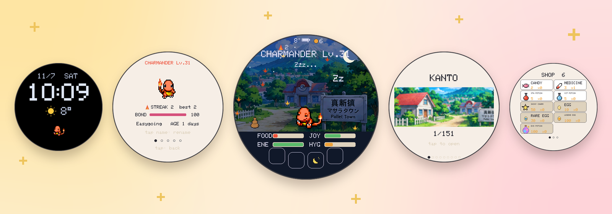

# TamaPoke with Chess

A gentle Pokémon pet that lives on real **chess.com** games.<br>
Play chess, earn points, and spend them on candy, eggs and potions for a companion that grows up over days.

[](#why-this-fork)
[](https://mu-muu.github.io/TamaPoke/web/)
[](#whats-different-from-upstream)
[](#hardware)
[](README.zh-CN.md)

**[chess.com points](#why-this-fork)** · **[What's different](#whats-different-from-upstream)** · **[Hardware](#hardware)** · **[Case](#3d-printed-case)** · **[Build and flash](#build-and-flash)** · **[How to play](#how-to-play)**

**English** · [简体中文](README.zh-CN.md)

<a href="https://mu-muu.github.io/TamaPoke/#build">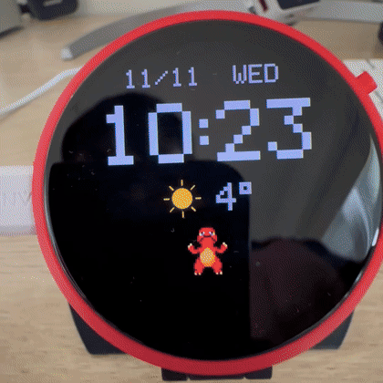</a>

</div>

**[Website](https://mu-muu.github.io/TamaPoke/)**: hatch an egg, try a chess puzzle and run a race in your browser, and watch a [clip of the real board](https://mu-muu.github.io/TamaPoke/#build). New to the game? Read the **[player's guide](https://mu-muu.github.io/TamaPoke/guide/)**.

**[Install it from your browser](https://mu-muu.github.io/TamaPoke/web/)** (Chrome or Edge on a computer, no Arduino needed).

A Pokémon virtual pet for the **Waveshare ESP32-S3-Touch-AMOLED-1.75** (round
466×466 AMOLED with touch). This is a fork of
[socquique/TamaPoke](https://github.com/socquique/TamaPoke) v1.18 that turns it
into a slower, gentler life sim: all **1025** species, an English and
**Simplified Chinese** UI, no battles, and a pet that grows up over days.

> **Personal, non-commercial fan project.** The code is MIT. The sprites come
> from PMD SpriteCollab (CC BY-NC 4.0). Pokémon is © Nintendo / Creatures /
> GAME FREAK / The Pokémon Company; this project isn't affiliated with or
> endorsed by them. See [Credits](#credits) and [License](#license).

## Why this fork

I made this for my daughter. She loves chess, but like any kid she sometimes
loses the drive to practise. So this pet lives on chess: the games she plays on
chess.com turn into points, and the points buy candy, potions, eggs and
accessories for her companion.

**Play on chess.com → the board syncs every night → points buy candy, eggs and
potions → the next morning the pet cheers about yesterday's games.**

- Only real games count: games with 10+ minutes of base time, or daily games.
  Blitz, bullet and games against bots don't. A win gives 10 points, a draw 7
  and a loss 5 (a lost game teaches as much as a won one), and new personal
  bests (rating, tactics, Puzzle Rush) give bonuses, so practice pays off.
- Everything else gives only a trickle of points (steps, a small farm
  harvest), so chess stays the main way to earn.
- Basic care (food, play, bath, sleep) is always free. Skipping chess never
  hurts the pet; playing just makes its life richer.
- The board syncs once a night, and the next day the pet cheers about
  yesterday's games ("You won 3 games!").
- It only reads chess.com's public data for one username (the
  [Published-Data API](https://www.chess.com/news/view/published-data-api)):
  no login, no password, and nothing is ever posted to chess.com.
- The username goes on the board's Wi-Fi setup page (see [Wi-Fi](#wi-fi)),
  so the web installer build earns chess points too. If you build the firmware
  yourself you can also set a default in `config_private.h` (see
  [Personal settings](#personal-settings)).

## What's different from upstream

| | Upstream v1.18 | This fork |
|---|---|---|
| Species | Gen 1 (151) | Gen 1-9 (1025), one Pokédex page per region |
| Languages | 8 | English + Simplified Chinese |
| Growing up | +1 level per hour, evolution by level, battle stats, ball minigame | evolution by age, a day of Mega Evolution, natures, sickness, abilities, no battles |
| Tournament | — | eleven events against two random Pokémon (track, pool, jumps, weights, climbing, diving, skating, torch run, trail run), played by stats and type, no fighting |
| Gyms | — | 8 gyms per region (72), 3-on-3 team events against the leaders and their anime Pokémon, badges, Elite Four and Champion |
| Fun | — | orchard, fishing, mining and treasure hunts by type; cost chess points, give fruits that raise training, eggs and Mega Stone shards |
| Friends | — | put two boards side by side to become friends: play together, gifts, photos, races and gyms together; when apart, visits, postcards and gifts (all encrypted) |
| On its own | — | behaviour planner, speech bubbles, self-care when plugged in |
| Collection | Pokédex gallery, streak, bond, medals | adds farm, album, stats page, accessories |
| Points | — | chess.com games, steps (also from an iPhone), hockey practice, region rewards → shop and fun |
| World | biome and time-of-day backgrounds | real weather, sunrise/sunset, seasons, holidays, region landscapes |
| Extras | battery, dimming, web installer | adds standby clock, NTP time, SD backup (daily or on demand), optional Stack-chan control |

## Hardware

- [ESP32-S3-Touch-AMOLED-1.75](https://www.waveshare.com/wiki/ESP32-S3-Touch-AMOLED-1.75)
  (Standard or -G; upstream notes that the "-B" version comes in a case that
  doesn't fit, and the "1.75C" is a different board).
- A microSD card (FAT32) for the sprites, farm, album and backups.
- Optional: a 3.7 V LiPo with an MX1.25 plug (check polarity), and a small
  speaker on the MX1.25 speaker connector.
- Optional: the 3D-printed Poké Ball case from upstream
  ([MakerWorld](https://makerworld.com/es/models/2937822-tamapoke-a-pokemon-pokeball-tamagotchi)),
  with 3 M2×4 mm screws and 4 disc magnets (6×2 mm). See
  [3D-printed case](#3d-printed-case).

### 3D-printed case

The case is upstream's Poké Ball on
[MakerWorld](https://makerworld.com/es/models/2937822-tamapoke-a-pokemon-pokeball-tamagotchi),
a remix of [“Pokeball” by yoyothechicken](https://makerworld.com/es/models/839922-pokeball).
The board sits in the red top half with the screen tilted toward you; the
optional battery and speaker go in the white bottom half. The print files and
print settings are on the MakerWorld page. Its firmware steps are for the
original project: for this fork, use the [web installer](#web-installer).

Besides the printed parts (two halves, a hinge ring, the power-button cover, the
button and the 4 alignment pins), you need:

- 3 M2×4 mm screws and a small Phillips screwdriver
- 4 disc magnets, 6×2 mm
- a little glue for the button
- optional: a LiPo of about 42 × 25.5 × 11 mm and a speaker of about
  30.5 × 20.5 × 6.7 mm (the sizes the MakerWorld page gives); a straight USB-C
  cable charges it through the slot in the side, without opening the ball

Putting it together:

1. **Flash and prepare the SD card first**, while the board is easy to reach
   (see [Build and flash](#build-and-flash)).
2. **Board:** lay it in the top half with the screen facing out through the
   window and fix it with the 3 M2×4 mm screws. Tighten only until the board
   no longer wobbles. Seat it gently: never bend or pull the screen's flex
   cable, or the panel can die.
3. **Power button** (only on the "external power button" print): fit the
   printed cover over the board's PWR button.
4. **Battery and speaker** (optional): put them in their pockets in the bottom
   half and plug them into the board's BAT and SPK connectors.
5. **Alignment pins:** push the 4 pins into the holes in the rim, the two 8 mm
   ones at the back and the two 6 mm ones at the front.
6. **Magnets:** press the 4 magnets into their recesses. Check that the two
   halves attract before you glue anything.
7. **Hinge:** clip each half onto the hinge ring. The print-in-place ring is the
   easy one; if it doesn't turn freely, print the other ring and push a short
   piece of 1.75 mm filament through it as the hinge pin. The ball now opens
   like a clamshell and the magnets keep it shut.
8. **Button:** push the inner button into the outer one and glue it onto one of
   the halves.

## Build and flash

The easiest way is the [web installer](#web-installer): a browser is all you
need. To build the firmware yourself, see [Build with Arduino](#build-with-arduino).

### Web installer

1. On a computer, open the [web installer](https://mu-muu.github.io/TamaPoke/web/)
   in **Chrome** or **Edge** (other browsers can't talk to USB devices).
2. Plug the board in with a USB-C cable, press **Install TamaPoke** and pick the
   board's port. It takes about a minute.
3. **Erase device:** tick it only on a new board or one that ran other
   firmware. **When updating, leave it unticked:** the installer then only
   writes the program, so your pet, points, friends and Wi-Fi stay. Ticking it
   wipes the board, pet included.
4. No port shows up? Try another cable (some only charge), or hold **BOOT**
   while plugging it in.
5. **SD card:** press **Download the SD files** on the same page (or get
   `tamapoke-sd.zip` from the
   [latest release](https://github.com/Mu-Muu/TamaPoke/releases/latest)),
   unzip it, copy the `mons` folder to the root of a FAT32 microSD card, put
   the card in the board and restart it. See [SD card](#sd-card).
6. **Wi-Fi:** swipe down to settings and tap **Wi-Fi** (see [Wi-Fi](#wi-fi)).

The installer build has neutral settings: an English UI (switch to Chinese in
settings), time and weather for wherever your internet connection is (found
once the board is online) or for a city you enter on the Wi-Fi page, and
chess.com points once you enter a username on that same page.

### Build with Arduino

Arduino core **esp32 3.3.x** (tested with 3.3.10) and these libraries
(tested versions):

| Library | Version | Used for |
|---|---|---|
| GFX Library for Arduino | 1.6.9 | CO5300 display over QSPI, framebuffer in PSRAM |
| SensorLib | 0.5.1 | CST9217 touch, PCF85063 RTC, QMI8658 IMU |
| XPowersLib | 0.3.3 | AXP2101 power management and PWR button |
| U8g2 | 2.36.19 | font support |
| ArduinoJson | 7.4.3 | chess.com, Open-Meteo, MCP |
| WebSockets (Markus Sattler) | 2.7.2 | Stack-chan / xiaozhi MCP |

Board settings: **ESP32S3 Dev Module**, Flash **16MB**, PSRAM **OPI**,
partition **16M Flash (3MB APP/9.9MB FATFS)**, USB CDC On Boot **Enabled**.

```bash
FQBN="esp32:esp32:esp32s3:CDCOnBoot=cdc,FlashSize=16M,PSRAM=opi,PartitionScheme=app3M_fat9M_16MB"
arduino-cli compile --fqbn "$FQBN" --output-dir build .
arduino-cli upload --fqbn "$FQBN" -p /dev/cu.usbmodemXXXX --input-dir build .
```

### Personal settings

Owner name, chess.com username, weather coordinates and time zone go in
`config_private.h`, which is git-ignored (a city or username entered on the
Wi-Fi page takes priority). Copy
[`config_private.example.h`](config_private.example.h) to `config_private.h`
and fill it in. Without it the firmware builds with neutral example values from
[`config.h`](config.h) (location found from the connection, chess.com username
only from the Wi-Fi page).

| Setting | What it does |
|---|---|
| `OWNER_NAME` | name used in a few lines ("I love you, …!", birthday); 16 bytes max |
| `CHESS_USER` | default chess.com username; one entered on the Wi-Fi page takes priority; empty = only from the Wi-Fi page |
| `WX_LAT`, `WX_LON`, `WX_TZ` | weather location and IANA time zone (`/` written as `%2F`); without them (and without a city on the Wi-Fi page) the board finds its location from the internet connection |
| `LOCAL_TZ` | POSIX time zone string for NTP |
| `TZ_STD_OFFSET_H`, `TZ_DST_NA` | standard UTC offset in hours, and whether the US/Canada DST rule applies (not used when the place comes from the Wi-Fi page or the connection: then the clock takes that place's current offset from Open-Meteo, daylight saving included) |
| `MAILBOX_URL`, `MAILBOX_KEY` | mailbox for mail with friends; ntfy.sh by default, nothing to set. For your own Cloudflare Worker, its address and key (see "Friends" below) |

### SD card

Copy the folder [`tools/sdcard/mons`](tools/sdcard/mons) (also in
`tamapoke-sd.zip` on the
[latest release](https://github.com/Mu-Muu/TamaPoke/releases/latest)) to the
root of the card, so the files end up in `/mons/` (about 290 MB: sprites, shiny sprites,
Pokédex thumbnails and the 9 region landscapes). `python3 tools/send_sd.py`
can also send them over USB, but that is slow for the full set.

**If the card can't be mounted, the firmware formats it.** Back up anything on
it first.

### Wi-Fi

On the settings page tap **Wi-Fi**. The board opens an access point called
`TamaPoke`; join it with a phone and open `192.168.4.1` (the page is in the
board's language). Enter up to three networks (for example home, school and a
phone hotspot: the board joins the strongest one it can see; 2.4 GHz only, so
on an iPhone hotspot turn on Maximize Compatibility), and optionally
your city and your chess.com username. The city sets the clock's time zone
(with daylight saving) and the weather; if several places share the name, add
the state or country after a comma (`Springfield, IL`, `Lyon, France`). The
board looks it up on [Open-Meteo](https://open-meteo.com/en/docs/geocoding-api)
the next time it is online, shows "City updated" (or "City not found"), and the
page then shows which place it found. Without a city, a board with no location
of its own in `config_private.h` (like the web installer build) finds it from
its internet connection with [ipapi.co](https://ipapi.co/) once it is online
(that service sees the board's public IP address, as every site it talks to
does). The clock follows the time zone of the phone that saved this page (the
page reads it from the phone's settings), because the internet provider's exit
can be far away, even in another time zone; in that case the weather comes from
the city the phone's time zone is named after (`America/Chicago` → Chicago). On
a VPN or some phone hotspots the place can be wrong, and then a city entered
here takes priority. The last field, **Stack-chan voice control**, is only
for a Stack-chan or another xiaozhi voice assistant (see
[Stack-chan / xiaozhi](#stack-chan--xiaozhi-optional)); otherwise leave it
empty. Everything is stored on the board only and never shown again (the page
only marks which networks are saved, and shows the city it found). Leave a field empty to keep what was
saved before, or enter `-` to remove a network (in its name), the city (back to
the default, or to the place found from the connection), the username or the voice control endpoint. After a new username, the next sync
only records that account's current marks.

## How to play

### Screens

From the main screen:

| Gesture | Opens |
|---|---|
| swipe **right** | Pokédex: one cover per region, swipe on to the next region, tap a cover to open its grid (up/down for pages, tap a Pokémon for details) |
| swipe **left** | activities: the farm (album button at the bottom), the tournament, the gyms and fun |
| swipe **up** | the pet's card: profile, abilities, medals (swipe left/right for pages) |
| swipe **down** | settings: clock, temperature unit (°C/°F), sound (high, medium, low or off), Wi-Fi, language, backup (save one now or restore it), stats, screen brightness (three levels), sync chess now |
| tap the **points** at the top | shop (items, eggs, accessories) |
| **long press** the pet | send it to the farm, or release it |

Buttons along the bottom: **Feed** (berry, candy, medicine), **Play**,
**Light** (sleep / wake) and **Bath** (cleans up poops).

Touching the pet: tap to pet it, stroke back and forth, double tap to make it
hop, poke the head or belly, tickle it (too much and it gets annoyed), drag it
to walk, draw a circle to spin it. Tilting the board makes it walk downhill,
laying it face down puts it to sleep, and a hard shake makes it dizzy.

<table><tr><td align="center">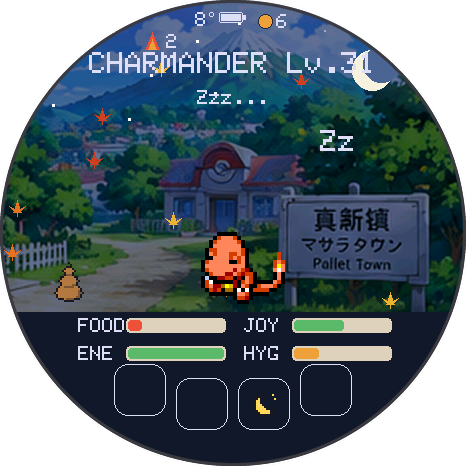<br>Main screen (asleep at night)</td><td align="center">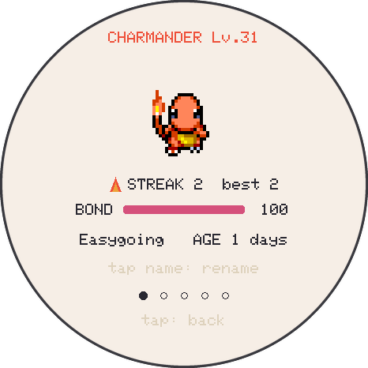<br>Pet card</td><td align="center">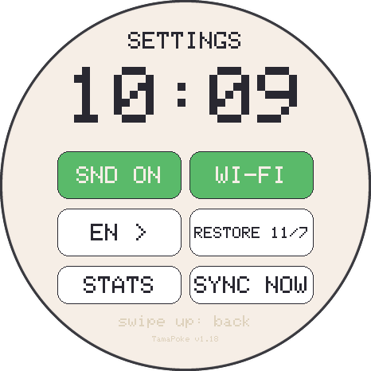<br>Settings</td></tr></table>

<table><tr><td align="center">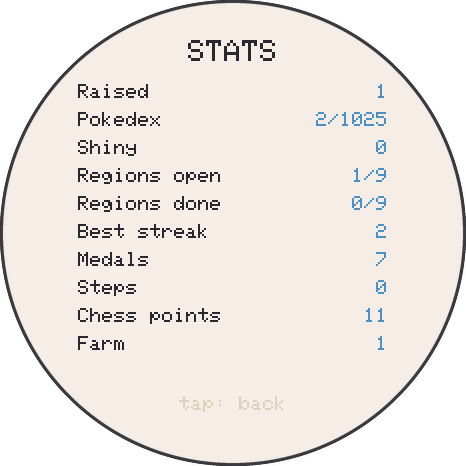<br>Stats</td><td align="center">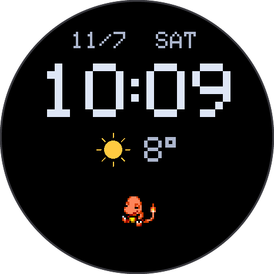<br>Standby clock</td></tr></table>

<table><tr><td align="center"><br>Activities (swipe left)</td></tr></table>

### Care

- Four needs from 0 to 100: food, joy, energy and hygiene. They drop every
  minute while awake and much slower while asleep. Poops lower hygiene.
- A need at 10 or below counts as a **care mistake** (at most one per hour).
  Two or more poops, being overweight, or a need at 20 or below can make it
  **sick**: give medicine, or every 2 hours sick counts as a mistake. If it
  stays sick and awake for 10 minutes it takes a medicine from the bag by
  itself. It never spends your points: with no medicine in the bag it stays
  sick until you give it one.
- If all four needs sit at 0 for an hour, a run-away button appears.
- **Night:** if the light is still on, it falls asleep by itself at 23:00 and
  wakes at 07:00. Turning the screen off with PWR also puts it to sleep, and
  only another press of PWR turns it back on: touches are ignored then, so it
  doesn't wake up in a pocket (if you laid it face down, turning it face up
  works too).
- **On battery:** after 5 minutes with nobody touching it, the screen turns
  off by itself and it goes to sleep, exactly as if you had pressed PWR, so its
  needs barely drop while you are away. Press PWR to wake it. Plugged in, the
  screen stays on and shows the standby clock instead.
- **Self-care:** while plugged in and with nobody touching it for 10 minutes,
  it brings any need below 40 back up to 50, one per minute, and it doesn't
  get sick. It does this silently: no animation, no sound, and the standby
  clock stays on. This doesn't count as your care.
- **Natures** (rolled at hatch): easygoing, glutton, playful, tidy, lazy. One
  need drops a little faster and its favourite care gives more.

<table><tr><td align="center"><br>Feeding</td><td align="center"><br>Bath</td><td align="center"><br>Head pat</td></tr></table>

### Growing up

- Evolution is by **age**, the same for every line: the first at 3 days, the
  second at 5 days. Each care mistake delays it by 2 hours and all needs must
  be at 40 or more. When it's ready, a button lets you evolve or keep the
  current form. An **evolution potion** (100 points) skips the wait in days; the
  needs still have to be at 40 or more.
- In its final form, after **7 days** it asks to retire (you can choose to stay
  together for a while). It then moves to the **farm**, where you can take it
  back any time; the album keeps the page, and you open a new egg.
- **Abilities** (0-100, no battles): strength (strength potion) slows energy loss
  by up to 50%, speed (speed potion) slows joy loss by up to 50%, and
  endurance grows by 1 for every 3 hours of good care (screen off counts in the
  daytime; night sleep and lights off pause it) and cuts the chance of
  getting sick by up to 60%. The endurance potion isn't sold: it turns up in the
  grass on the main screen and on Fun treasure hunts, and waits on the harvest
  page of the bag. In the tournament and the gyms each one helps where
  its stats count: strength with Attack, speed with Speed, endurance with HP and
  Defense.

<table><tr><td align="center">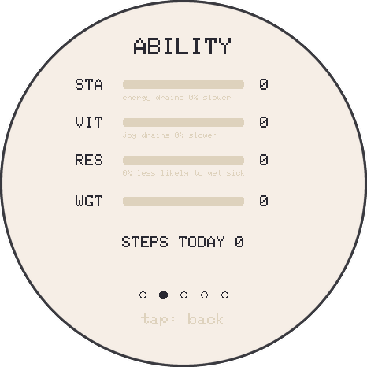<br>Abilities</td><td align="center">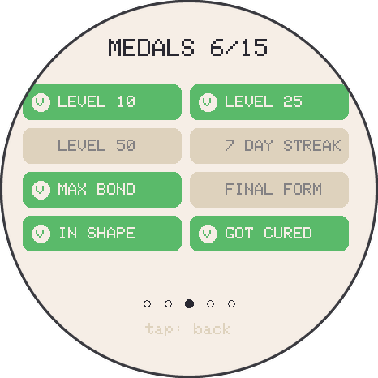<br>Medals</td></tr></table>

### Points and shop

You start with 10 points. Basic care is free.

- **chess.com** (once a username is set on the Wi-Fi page or in
  `CHESS_USER`): synced once a day at midnight, on
  the next boot, or with **Sync now**. A game with 10+ minutes base time or a
  daily game gives 10 points for a win, 7 for a draw and 5 for a loss; games
  without a clock (bots) don't count. A new best rapid or daily rating gives 20, each new hundred in rapid
  50, a new tactics or Puzzle Rush best 10. The first sync, and the first after
  changing the username, only records your current marks.
- **Steps** from the accelerometer, also with the screen off (not while the
  board is switched off with a long press): 1 point per 1000 steps (5 a day at
  most), and 10 more the day you reach 10,000. An iPhone can send its own count
  (see [Steps from an iPhone](#steps-from-an-iphone)); the higher of the two counts.
- Completing a region's Pokédex: 200 points, a crown and a shiny legendary egg
  from that region.
- A small daily farm harvest after 07:00.
- **Rewards from home**: a parent's iPhone can give points for anything (chores,
  reading, a good day), up to 20 a day (see [Rewards from a parent's iPhone](#rewards-from-a-parents-iphone)).

| Item | Points |
|---|---|
| Candy (joy and food, but fattening) | 2 |
| Medicine | 3 |
| Strength potion / speed potion | 5 each |
| Evolution potion | 100 |
| Mega Stone (also from a tournament gold, one a day) | 150 |
| Shiny charm | 50 |
| Common / rare / legendary egg | 10 / 30 / 100 |
| Accessories (bow, flower, cap, witch hat, top hat, crown) | 15-80 |

Eggs can only be opened when you have no partner. Swipe left in the shop for the
bag, then the **harvest** (what you get from [Fun](#fun)), then accessories, then the points book.

Buying asks first (YES / NO), and so does anything in [Fun](#fun) that costs points.

The **points book** is the last page of the shop (or tap the points at the top of the shop): this week
day by day, points earned (green) and spent (orange), where they came from (chess, steps, hockey, rewards from home, other) and
where they went (shop, fun), and last week. Every Monday the main screen shows a short summary of
last week.

<table><tr><td align="center">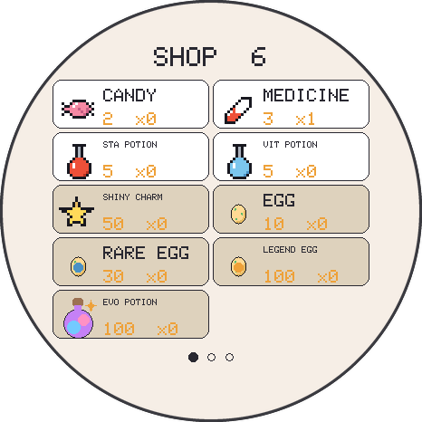<br>Shop</td><td align="center">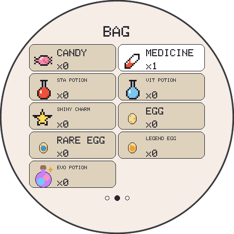<br>Bag</td><td align="center">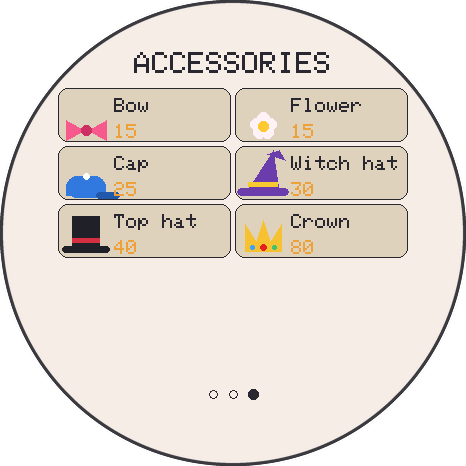<br>Accessories</td></tr></table>

<table><tr><td align="center"><br>Confirm before buying</td><td align="center"><br>Points book</td></tr></table>

### Surprises in the grass

Now and then a tuft of grass rustles on the ground of the main screen: tap it to
find what's hidden there. One a day (two candies, a medicine, a potion or a
common egg), one a week from Monday (a rare egg, a shiny charm or two potions: endurance plus strength or speed,
with blue sparkles) and one a month (a legendary egg, a Mega Stone or an
evolution potion, with gold sparkles). The most valuable one shows first. They
never give points.

<table><tr><td align="center"><br>A rustling clump of grass</td></tr></table>

### Pokédex, farm and album

- The 9 regions open in order: the next one opens once every common and rare
  species of the previous one has been registered. Eggs only bring species
  from open regions.
- The **farm** keeps companions you send there on the SD card. They keep
  growing at a tenth of the speed (without evolving), come back healthy, and
  sometimes walk across the main screen. Species in the farm don't come out of
  eggs or evolutions.
- The **album** keeps one page per companion that has left, with dates, level,
  medals and how it ended.
- A **backup** of the game is written to the SD once a day (Wi-Fi details are
  not included). In settings, **BACKUP** saves a fresh one at any moment
  (**SAVE NOW**) or brings it back (**RESTORE**); both ask first.
- **Moving to another board:** SAVE NOW on the old board, then put its SD card
  in the new one (the card also holds the farm, the album and the friend
  photos). Flash the new board, pick any starter, set up Wi-Fi so the clock is
  right, and RESTORE. When the new board looks right, erase the old one with
  the web installer, so two boards don't share one game.

<table><tr><td align="center">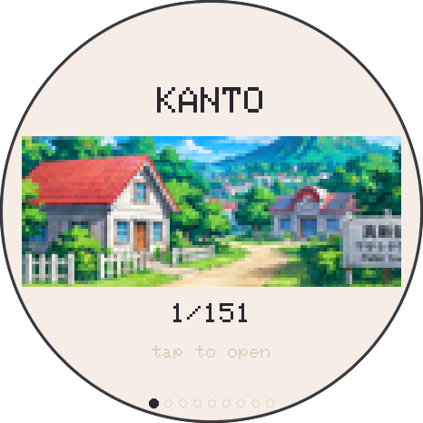<br>Region cover</td><td align="center">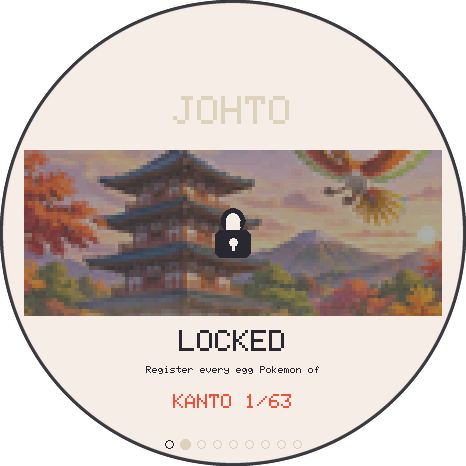<br>Locked region</td><td align="center">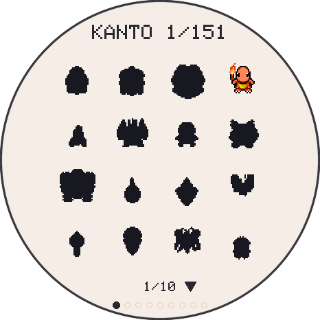<br>Region grid</td></tr></table>

<table><tr><td align="center">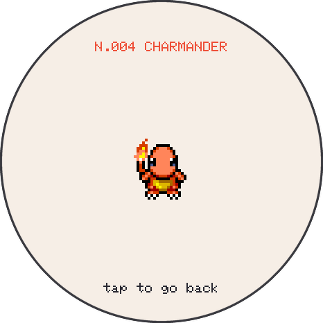<br>Pokédex entry</td><td align="center">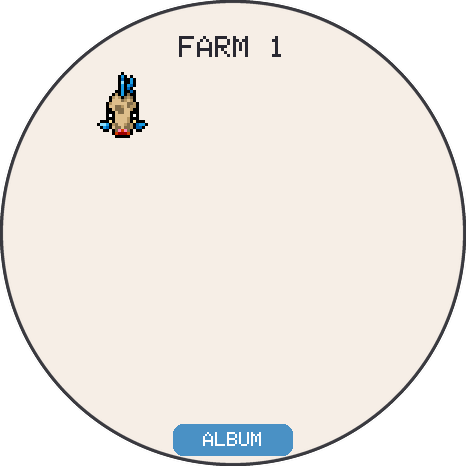<br>Farm</td><td align="center">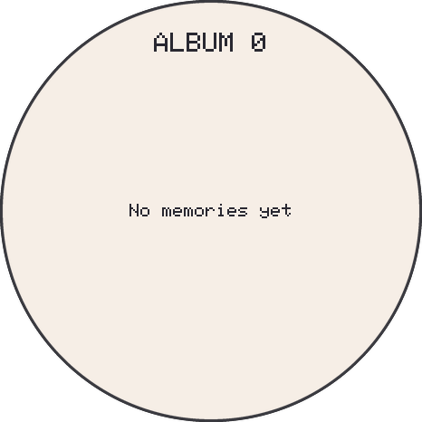<br>Album</td></tr></table>

### Tournament

Swipe left from the main screen and tap **Tournament**, then pick one of the eleven events. Your
companion competes against two Pokémon drawn at random, each at the event's own
venue. Nobody taps and nobody fights: it plays out by itself.

Who does well depends on what each Pokémon is: its species' stats (each event
weighs them its own way), its genes and training, its evolution stage, Mega
Evolution (+15%) and its type. Rivals get random genes and training, and every
event has a bit of luck, so the strongest doesn't always win.

| Event | What counts | Type bonus | Venue |
|---|---|---|---|
| 100m dash | speed | Electric +15%, Fighting +10% (Rock, Steel -10%) | running track with stands |
| Hurdles | speed and spring | Fighting +15%, Bug +10% (Rock, Steel -10%) | track with hurdles |
| 50m swim | speed and stamina | Water +25%, Ice +10% (Fire, Rock -15%) | pool with lane ropes |
| Long jump | power and speed | Fighting, Flying +15% (Rock, Steel -10%) | run-up, board and sand pit |
| High jump | power | Flying +25%, Psychic +15% (Rock, Steel -15%) | bar and mat |
| Weights | power and steadiness | Fighting +20%, Steel, Rock +15% (Flying, Fairy, Bug -10%) | stage with spotlights |
| Climbing | power and speed | Rock +20%, Ground +15%, Bug +10% (Water, Steel -10%) | climbing wall |
| Diving | technique | Water +20%, Psychic, Flying, Fairy +10% (Fire, Rock -15%) | platform and pool |
| Skating | speed | Ice +25%, Fairy +10% (Fire -15%) | ice rink |
| Torch run | stamina | Fire +25%, Dragon +10% (Water, Ice -10%) | city road |
| Trail run | a bit of everything | Dark, Ghost +15%, Poison, Grass +10% (Steel, Rock -10%) | forest trail with logs |

A gold medal cheers it up and, the first one each day, gives a **Mega Stone**.
Competing tires it a little; it can't take part asleep, sick or very tired.

<table><tr><td align="center"><br>Tournament</td><td align="center"><br>Torch run</td><td align="center"><br>Podium</td></tr></table>

### Gyms

Swipe left from the main screen and tap **Gyms**. Every region has 8 gyms (72 in
all) with the leaders and badges from the games, and three Pokémon each leader
used in the anime. It's still sport, not battles: each gym picks the three
events that suit its type best, and it's a 3-on-3 team contest.

- Your team is your companion plus two Pokémon you pick from the farm (you need
  at least two there). Before starting you can swap who does which event; the
  leader puts each of theirs where they do best.
- Each event is one against one: win two of the three and the badge is yours.
- Gyms open with their region and go in order: you need the badge of the one
  before. One try per gym per day.
- Each gym is harder than the last: the leaders' Pokémon get better genes and
  more training.
- Badges 2, 4 and 6 of a region also give a rare egg, badge 8 a legendary egg.
- With all 8 badges the region's **League** opens: the Elite Four and then the
  Champion, one after the other (one try a day). The first win gives a
  legendary egg and a Shiny Charm.

The gym list is also the badge case: swipe left/right to change region.

<table><tr><td align="center"><br>Gyms and badges</td><td align="center"><br>A gym</td><td align="center"><br>Lineup</td></tr></table>

### Fun

Swipe left from the main screen and tap **Fun**. There are four activities and
every type has one. Your companion goes if it's the right type (awake, healthy
and not too tired); otherwise you pick one of the right type from the farm, so
collecting different types pays off.

| Activity | Types | Cost | How | What you get |
|---|---|---|---|---|
| Orchard | Grass, Bug, Ground, Poison, Fairy | 8 per plot | 3 plots in real time: plant, water once (ripe in 12 h, 24 h if not watered), harvest | 2-3 fruits |
| Fishing | Water, Ice, Dragon | 5 | cast, then tap when the float dips | fish, pearls, now and then a water-type egg |
| Mining | Rock, Steel, Fighting, Fire | 10 | tap the rock until it breaks | Mega Stone shards (10 make a stone), sometimes a fossil egg |
| Treasure | Normal, Flying, Electric, Psychic, Ghost, Dark | 8 | it sets off for an hour, then you collect | candy, medicine, potions, an accessory, rarely a shiny charm |

Fun **costs points and never gives any**: points still come from chess. Chess
also brings luck the same day: if you played, one more thing from every
activity; if you won, the rare finds are twice as likely.

- **Fruits** raise training: strength fruit, endurance fruit and speed fruit
  +3 each, the gold fruit +3 to all three and full joy. Up to 3 a day per
  Pokémon raise anything (after that they're just a snack). Training helps in
  the tournament and the gyms, and farm Pokémon can eat fruits too (tap one at
  the top of their page in the farm), since gym teammates use their own training.
- **Fish** fills it up, a **pearl** makes it very happy. Fish and fruits are also in the
  **Feed** menu (a second row, when you have some).
- While the companion is out on a treasure hunt, the main screen shows a sign
  with the minutes left.

<table><tr><td align="center"><br>Fun</td><td align="center"><br>Orchard</td><td align="center"><br>Fishing</td></tr></table>

### Friends: meet and mail

When a friend has a board too, the two can become friends. Swipe left on the main screen and tap **FRIENDS**: **MEET** is at
the top and your friends are listed below. Both boards need this firmware or newer.

**Meet (boards side by side)**: both open **MEET** and each board finds the other when they are close.
Tap the other board and say yes on both; the two screens show the same 4-digit code, and once it matches you
are friends. While the page is open the boards talk directly over radio (ESP-NOW) and home Wi-Fi pauses; it
comes back when the page closes or after 3 idle minutes.

With a friend nearby:

- **Play**: the two Pokémon run, catch and dance together; when both kids tap their own Pokémon at once, they high-five.
- **Gift**: pick something from the bag; it only goes if the friend accepts, otherwise it comes back.
- **Race and gyms together**: a tournament race with a third random rival; at a gym the one who invites brings two and the friend's companion is the third.
- **Photo**: one per friend per day, the first time you meet, kept on the SD card and shown on the friend page. The Pokédex also marks species a friend has raised (they don't count as raised by you).

**Mail (when apart)**: after meeting once, both boards know each other's mailbox. In the **FRIENDS** list a
friend you can write to says "Visit, card, gift"; one that says "Meet once to mail" (for example a friend made
before mail existed) needs one more **MEET** first. Tap the friend and pick:

- **VISIT**: your companion goes to their screen. Their board says whose Pokémon came to see them, and your
  companion stays there 3 minutes. You need a companion (not an egg), and you can visit each friend up to 3 times a day.
- **POSTCARD**: pick a messenger (your companion or any Pokémon on your farm; it only carries the card and
  doesn't leave your farm), then one of 12 phrases and one of 8 pictures. The phrases: Hello! · Miss you! ·
  Let's play! · See you tomorrow! · Good morning! · Sweet dreams! · Thank you! · You can do it! · Happy
  birthday! · Had a great day! · Won at chess today! · My Pokemon evolved!
- **GIFT**: pick a messenger, then an item from the bag. It leaves your bag when you send it.

The board asks before anything goes, then says "Sent! Arrives at the next sync". Both boards need Wi-Fi. Mail
goes out and comes in at the next sync: every 15 minutes on USB, with the weather on battery, or sooner with
**SYNC NOW** at the bottom of the friends page. The friend's row shows how many postcards and gifts are
still on the way; with too many waiting, the board asks you to wait a bit.

On the friend's board the messenger walks onto the main screen and waits with an envelope or a gift box until
someone taps it ("Tap to open"). It shows the postcard or the gift, stays 3 minutes and leaves; a gift goes
into the bag. Postcards and gifts are resent every 4 hours until the friend's board confirms them; a visit is
sent only once. A gift that isn't confirmed within 14 days comes back to your bag ("A gift came back to your
bag"). You can have up to 4 friends. Meeting and mail **give no points**.

Mail goes through an internet mailbox, [ntfy.sh](https://ntfy.sh) by default (free, no account). Everything is
encrypted and signed with the key made when the two boards paired, so the mailbox only sees noise. To use your
own mailbox, deploy the free Cloudflare Worker in [`tools/mailbox-worker`](tools/mailbox-worker/README.md) and
set `MAILBOX_URL` and `MAILBOX_KEY` in `config_private.h`. Friends belong to the save, not the board: move a
save to another board and your friends still know it.

<table><tr><td align="center"><br>Friends</td><td align="center"><br>Meet</td><td align="center"><br>A friend nearby</td></tr></table>

<table><tr><td align="center"><br>Play together</td><td align="center"><br>A messenger arrives</td><td align="center"><br>Postcard</td></tr></table>

### Mega Evolution

Use a **Mega Stone** from the bag: the 41 species that have Mega sprites in PMD
SpriteCollab (Charizard X, Mewtwo Y, Gengar, Lucario, Rayquaza...) Mega Evolve
for 24 hours, then change back. The stone isn't used up if your companion has
no Mega form. The sprites are `mons/mNNN.bin` on the SD (`tools/pack_pmd.py mega`).

### Steps from an iPhone

The board can take the day's steps from the iPhone's Health app (handy when the
board stays at home). It has to be plugged in and on the home Wi-Fi; the phone on
the same network. The code is on the stats page (settings → stats → "Phone
steps code").

In the **Shortcuts** app: Automation → New Automation → **Time of Day** (for
example 9:00 PM, daily) → Run Immediately, with these actions:

1. **Find Health Samples** where Type is **Steps** and Start Date is **Today**.
2. **Calculate Statistics**: **Sum** of the Health Samples.
3. **Get Contents of URL**: `http://tamapoke.local/steps?n=` + the Sum + `&k=` + your code.

The first time iOS asks to allow local network access: allow it. Health data is
locked while the phone is locked, so pick a time when it's usually in use (or
run the shortcut by hand). The board keeps the higher of the phone's count and
its own, so nothing is counted twice.

### Hockey practice from an iPhone

A second shortcut sends minutes of hockey practice (on a SuperDeker or anything
else): **1 point every 5 minutes, up to 6 a day**. Several sessions in a day add up,
the main screen shows today's minutes and points, and the points book has a
"hockey" line. Keep it on a parent's phone so the points stay honest.

In the **Shortcuts** app, a new shortcut with:

1. **Ask for Input**: type **Number**, prompt "Minutes of hockey practice?".
2. **Get Contents of URL**: `http://tamapoke.local/hockey?min=` + Provided Input + `&k=` + your code (the same one as for steps).
3. **Show Result** (optional): the board answers `{"ok":true,"min":15}`.

Same conditions as the steps: board plugged in, phone on the home Wi-Fi.

### Rewards from a parent's iPhone

A third shortcut lets a parent give points for anything they like (chores, reading,
a good day): **1 to 10 points at a time, up to 20 a day**. The board wakes up and
shows "REWARD" with the points, and the points book has a "reward" line. Keep it on
a parent's phone.

In the **Shortcuts** app, a new shortcut with:

1. **Ask for Input**: type **Number**, prompt "How many points? (1-10)".
2. **Get Contents of URL**: `http://tamapoke.local/reward?pts=` + Provided Input + `&k=` + your code (the same one as for steps).
3. **Show Result** (optional): the board answers `{"ok":true,"pts":5}`.

Same conditions as the steps: board plugged in, phone on the same Wi-Fi as the board.

### World and power

- Weather from Open-Meteo: every hour when plugged in, every 3 hours on battery
  (not between 00:00 and 06:00). Rain, snow, fog and storms show on screen and
  affect moods by type; sunrise and sunset drive day and night.
- Seasons, holidays (New Year, Lunar New Year, Lantern Festival, Valentine's,
  Easter, Mother's and Father's Day, Dragon Boat, Canada Day, Mid-Autumn,
  Thanksgiving, Halloween, Christmas) and a birthday (set over serial with
  `BDAY month day`).
- **Standby clock:** plugged in and untouched for 90 seconds, the screen shows
  a large clock with the date and weather.
- Time comes from NTP at boot and every hour.

<table><tr><td align="center"><br>Snowy night</td><td align="center"><br>Christmas</td><td align="center"><br>Halloween</td></tr></table>

### Stack-chan / xiaozhi (optional)

The board doesn't talk to the robot or to the language model directly: a
Stack-chan (or any other xiaozhi device) runs on the xiaozhi voice service,
and xiaozhi gives each agent an MCP endpoint that outside tools can join. Copy
it from the MCP page of the assistant's app (it looks like
`wss://api.xiaozhi.me/mcp/?token=...`) into **Stack-chan voice control** on the
Wi-Fi page. Which model the agent uses (Qwen, DeepSeek...) makes no difference.

With that endpoint saved and USB power, the board stays online as an
MCP server. A xiaozhi agent (for example on a Stack-chan) can then check the
pet's status and feed it, play with it, bathe it, put it to bed or wake it,
give candy or medicine, report chess points and Pokédex progress, buy cheap
items and list the farm.

## Development

```bash
./test/run_tests.sh            # host tests (C++)
python3 test/test_tools.py     # sketch and tool checks
python3 tools/test_i18n_formats.py
```

- Chinese font: `tools/make_zh_font.py` builds `zhfont.h` from the WenQuanYi
  BDF files in the U8g2 repository (`tools/font/bdf`), with only the characters
  that are actually drawn. Run it again after adding Chinese text.
- Region pictures: `tools/make_regions.py` builds `regions.h` and the `bgN.bin`
  backgrounds from `tools/assets/regions_source.png`.
- Pokédex data: generated from PokéAPI (`tools/gen_dex*.py`).
- Serial console at 115200 baud for debugging, for example `HEALTH`, `STATS`,
  `SHOT` (screen dump), `WX`, `SYNC`.
- Before publishing, `tools/privacy_check.py` scans what would be uploaded for
  the values in `config_private.h` and an optional local `.privacy_denylist`.
  It can run as a `pre-push` hook.
- Website: `website/` is a Next.js static site (`npm ci && npm run build`, output
  in `website/out`). The Website workflow publishes it to GitHub Pages together
  with the installer (`web/`). Its tournament uses a port of `sport.h`: after
  changing `sport.h`, run `bash website/scripts/check-sport.sh` to compare the two.
- CI doesn't run for changes that only touch `website/`, `web/`, `docs/` or
  Markdown files.

## Credits

- Original project: [socquique/TamaPoke](https://github.com/socquique/TamaPoke)
  by Quique Tortosa and contributors.
- Sprites: [PMD SpriteCollab](https://github.com/PMDCollab/SpriteCollab)
  (CC BY-NC 4.0; per-sprite credits in its `tracker.json`).
- Species data and names: [PokéAPI](https://pokeapi.co).
- Chinese font: WenQuanYi Bitmap Song, from the
  [U8g2](https://github.com/olikraus/u8g2) repository.
- Weather data by [Open-Meteo.com](https://open-meteo.com/) (CC BY 4.0).
- Chess data from the [chess.com Published-Data API](https://www.chess.com/news/view/published-data-api).
- Libraries: Arduino_GFX (moononournation), SensorLib and XPowersLib (Lewis
  He), U8g2 (olikraus), ArduinoJson (Benoît Blanchon), WebSockets (Markus
  Sattler).
- Region landscapes: AI-generated for this fork.

## License

- Code: MIT, see [LICENSE](LICENSE). This fork's changes are under the same
  license.
- Sprites (`tools/sdcard/mons`): CC BY-NC 4.0, from PMD SpriteCollab. Don't
  use them commercially.
- Upstream's 3D case on MakerWorld: CC BY-NC-SA. The 3D model on the website
  (`website/public/models/tamapoke_case.glb`) is made from it, under the same
  license; see [website/case3d](website/case3d/README.md).
- Pokémon names and characters belong to their owners.
