<div align="center">

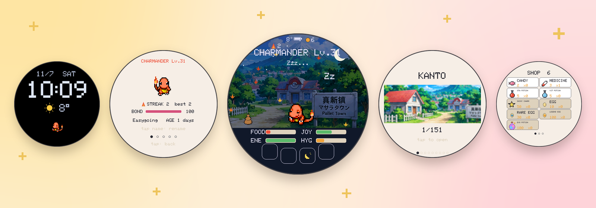

# TamaPoke

A gentle Pokémon pet that lives on real **chess.com** games.<br>
Play chess, earn points, and spend them on candy, eggs and potions for a companion that grows up over days.

[](#why-this-fork)
[](https://mu-muu.github.io/TamaPoke/web/)
[](#whats-different-from-upstream)
[](#hardware)
[](README.zh-CN.md)

**[chess.com points](#why-this-fork)** · **[What's different](#whats-different-from-upstream)** · **[Hardware](#hardware)** · **[Build and flash](#build-and-flash)** · **[How to play](#how-to-play)**

**English** · [简体中文](README.zh-CN.md)

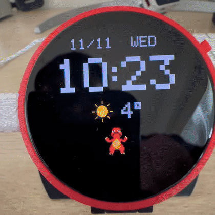

</div>

**[Install it from your browser](https://mu-muu.github.io/TamaPoke/web/)** (Chrome or Edge on a computer, no Arduino needed).

A Pokémon virtual pet for the **Waveshare ESP32-S3-Touch-AMOLED-1.75** (round
466×466 AMOLED with touch). This is a fork of
[socquique/TamaPoke](https://github.com/socquique/TamaPoke) v1.18 that turns it
into a slower, gentler life sim: all **1025** species, an English and
**Simplified Chinese** UI, no battles, and a pet that grows up over days.

> **Personal, non-commercial fan project.** The code is MIT. The sprites come
> from PMD SpriteCollab (CC BY-NC 4.0). Pokémon is © Nintendo / Creatures /
> GAME FREAK / The Pokémon Company; this project isn't affiliated with or
> endorsed by them. See [Credits](#credits) and [License](#license).

## Why this fork

I made this for my daughter. She loves chess, but like any kid she sometimes
loses the drive to practise. So this pet lives on chess: the games she plays on
chess.com turn into points, and the points buy candy, potions, eggs and
accessories for her companion.

**Play on chess.com → the board syncs every night → points buy candy, eggs and
potions → the next morning the pet cheers about yesterday's games.**

- Only real games count: games with 10+ minutes of base time, or daily games.
  Blitz, bullet and games against bots don't. A win gives 10 points and any
  other result 1, and new personal bests (rating, tactics, Puzzle Rush) give
  bonuses, so practice pays off.
- Everything else gives only a trickle of points (steps, a small farm
  harvest), so chess stays the main way to earn.
- Basic care (food, play, bath, sleep) is always free. Skipping chess never
  hurts the pet; playing just makes its life richer.
- The board syncs once a night, and the next day the pet cheers about
  yesterday's games ("You won 3 games!").
- It only reads chess.com's public data for one username (the
  [Published-Data API](https://www.chess.com/news/view/published-data-api)):
  no login, no password, and nothing is ever posted to chess.com.
- The username is set when you build the firmware (see
  [Personal settings](#personal-settings)); the web installer build has no
  chess points for now.

## What's different from upstream

| | Upstream v1.18 | This fork |
|---|---|---|
| Species | Gen 1 (151) | Gen 1-9 (1025), one Pokédex page per region |
| Languages | 8 | English + Simplified Chinese |
| Growing up | +1 level per hour, evolution by level, battle stats, ball minigame | evolution by age, natures, sickness, abilities, no battles or minigame |
| On its own | — | behaviour planner, speech bubbles, self-care when plugged in |
| Collection | Pokédex gallery, streak, bond, medals | adds farm, album, stats page, accessories |
| Points | — | chess.com games, steps, region rewards → shop |
| World | biome and time-of-day backgrounds | real weather, sunrise/sunset, seasons, holidays, region landscapes |
| Extras | battery, dimming, web installer | adds standby clock, NTP time, daily SD backup, optional Stack-chan control |

## Hardware

- [ESP32-S3-Touch-AMOLED-1.75](https://www.waveshare.com/wiki/ESP32-S3-Touch-AMOLED-1.75)
  (Standard or -G; upstream notes that the "-B" version comes in a case that
  doesn't fit, and the "1.75C" is a different board).
- A microSD card (FAT32) for the sprites, farm, album and backups.
- Optional: a 3.7 V LiPo with an MX1.25 plug (check polarity), and a small
  speaker on the MX1.25 speaker connector.
- Optional: the 3D-printed Poké Ball case from upstream
  ([MakerWorld](https://makerworld.com/es/models/2937822-tamapoke-a-pokemon-pokeball-tamagotchi)).

## Build and flash

Arduino core **esp32 3.3.x** (tested with 3.3.10) and these libraries
(tested versions):

| Library | Version | Used for |
|---|---|---|
| GFX Library for Arduino | 1.6.9 | CO5300 display over QSPI, framebuffer in PSRAM |
| SensorLib | 0.5.1 | CST9217 touch, PCF85063 RTC, QMI8658 IMU |
| XPowersLib | 0.3.3 | AXP2101 power management and PWR button |
| U8g2 | 2.36.19 | font support |
| ArduinoJson | 7.4.3 | chess.com, Open-Meteo, MCP |
| WebSockets (Markus Sattler) | 2.7.2 | Stack-chan / xiaozhi MCP |

Board settings: **ESP32S3 Dev Module**, Flash **16MB**, PSRAM **OPI**,
partition **16M Flash (3MB APP/9.9MB FATFS)**, USB CDC On Boot **Enabled**.

```bash
FQBN="esp32:esp32:esp32s3:CDCOnBoot=cdc,FlashSize=16M,PSRAM=opi,PartitionScheme=app3M_fat9M_16MB"
arduino-cli compile --fqbn "$FQBN" --output-dir build .
arduino-cli upload --fqbn "$FQBN" -p /dev/cu.usbmodemXXXX --input-dir build .
```

Or skip the build: the [web installer](https://mu-muu.github.io/TamaPoke/web/) flashes this fork
from Chrome or Edge. It has neutral settings (New York time and weather, no
chess.com points), and the SD files are `tamapoke-sd.zip` on the
[latest release](https://github.com/Mu-Muu/TamaPoke/releases/latest).

### Personal settings

Owner name, chess.com username, weather coordinates and time zone go in
`config_private.h`, which is git-ignored. Copy
[`config_private.example.h`](config_private.example.h) to `config_private.h`
and fill it in. Without it the firmware builds with neutral example values from
[`config.h`](config.h) (New York, no chess sync).

| Setting | What it does |
|---|---|
| `OWNER_NAME` | name used in a few lines ("I love you, …!", birthday); 16 bytes max |
| `CHESS_USER` | chess.com username in lowercase; empty = no chess points |
| `WX_LAT`, `WX_LON`, `WX_TZ` | Open-Meteo location and IANA time zone (`/` written as `%2F`) |
| `LOCAL_TZ` | POSIX time zone string for NTP |
| `TZ_STD_OFFSET_H`, `TZ_DST_NA` | standard UTC offset in hours, and whether the US/Canada DST rule applies |

### SD card

Copy the folder [`tools/sdcard/mons`](tools/sdcard/mons) to the root of the
card, so the files end up in `/mons/` (about 290 MB: sprites, shiny sprites,
Pokédex thumbnails and the 9 region landscapes). `python3 tools/send_sd.py`
can also send them over USB, but that is slow for the full set.

**If the card can't be mounted, the firmware formats it.** Back up anything on
it first.

### Wi-Fi

On the settings page tap **Wi-Fi**. The board opens an access point called
`TamaPoke`; join it with a phone and open `192.168.4.1`. Enter your network
and password, and optionally a xiaozhi MCP endpoint. They are stored on the
board only and never shown again.

## How to play

### Screens

From the main screen:

| Gesture | Opens |
|---|---|
| swipe **right** | Pokédex: one cover per region, swipe on to the next region, tap a cover to open its grid (up/down for pages, tap a Pokémon for details) |
| swipe **left** | farm (album button at the bottom) |
| swipe **up** | the pet's card: profile, abilities, medals (swipe left/right for pages) |
| swipe **down** | settings: clock, sound, Wi-Fi, language, restore backup, stats, sync chess now |
| tap the **points** at the top | shop (items, eggs, accessories) |
| **long press** the pet | send it to the farm, or release it |

Buttons along the bottom: **Feed** (berry, candy, medicine), **Play**,
**Light** (sleep / wake) and **Bath** (cleans up poops).

Touching the pet: tap to pet it, stroke back and forth, double tap to make it
hop, poke the head or belly, tickle it (too much and it gets annoyed), drag it
to walk, draw a circle to spin it. Tilting the board makes it walk downhill,
laying it face down puts it to sleep, and a hard shake makes it dizzy.

<table><tr><td align="center">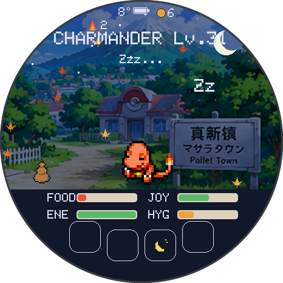<br>Main screen (asleep at night)</td><td align="center">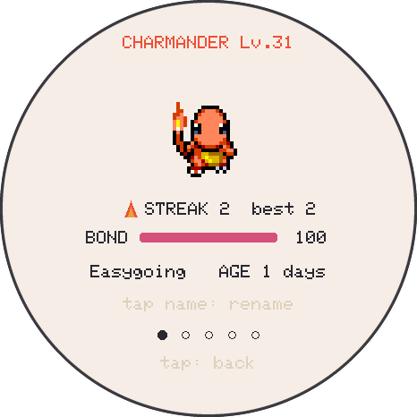<br>Pet card</td><td align="center">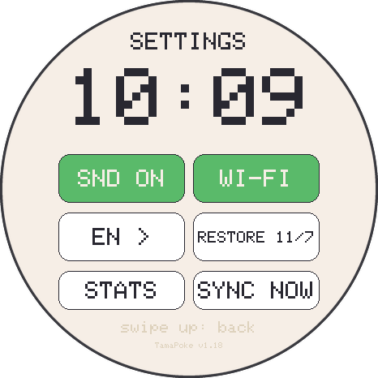<br>Settings</td></tr></table>

<table><tr><td align="center">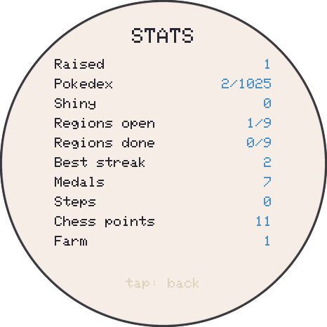<br>Stats</td><td align="center">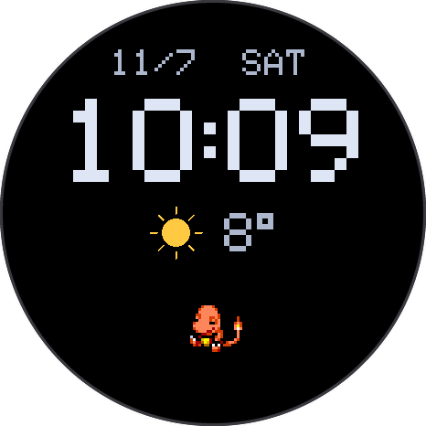<br>Standby clock</td></tr></table>

### Care

- Four needs from 0 to 100: food, joy, energy and hygiene. They drop every
  minute while awake and much slower while asleep. Poops lower hygiene.
- A need at 10 or below counts as a **care mistake** (at most one per hour).
  Two or more poops, being overweight, or a need at 20 or below can make it
  **sick**: give medicine, or every 2 hours sick counts as a mistake. If it
  stays sick and awake for 10 minutes it takes a medicine from the bag by
  itself. It never spends your points: with no medicine in the bag it stays
  sick until you give it one.
- If all four needs sit at 0 for an hour, a run-away button appears.
- **Night:** if the light is still on, it falls asleep by itself at 23:00 and
  wakes at 07:00. Turning the screen off with PWR also puts it to sleep.
- **Self-care:** while plugged in and with nobody touching it for 10 minutes,
  it brings any need below 40 back up to 50, one per minute, and it doesn't
  get sick. This doesn't count as your care.
- **Natures** (rolled at hatch): easygoing, glutton, playful, tidy, lazy. One
  need drops a little faster and its favourite care gives more.

### Growing up

- Evolution is by **age**, the same for every line: the first at 3 days, the
  second at 5 days. Each care mistake delays it by 2 hours and all needs must
  be at 40 or more. When it's ready, a button lets you evolve or keep the
  current form. An **evolution potion** (100 points) lets it evolve now.
- In its final form it says goodbye after **7 days** (you can choose to stay
  together for a while). It then goes to the album, and you open a new egg.
- **Abilities** (0-100, no battles): stamina (stamina potion) slows energy loss
  by up to 50%, vitality (vitality potion) slows joy loss by up to 50%, and
  resistance grows by 1 for every 3 hours of good care and cuts the chance of
  getting sick by up to 60%.

<table><tr><td align="center">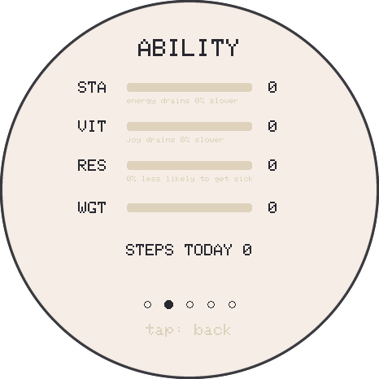<br>Abilities</td><td align="center">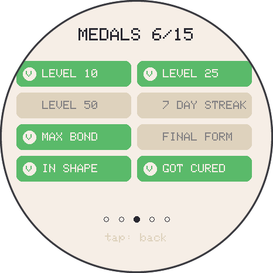<br>Medals</td></tr></table>

### Points and shop

You start with 10 points. Basic care is free.

- **chess.com** (if `CHESS_USER` is set): synced once a day at midnight, on
  the next boot, or with **Sync now**. A game with 10+ minutes base time or a
  daily game gives 1 point, a win 10; games without a clock (bots) don't
  count. A new best rapid or daily rating gives 20, each new hundred in rapid
  50, a new tactics or Puzzle Rush best 10. The first sync only records your
  current marks.
- **Steps** from the IMU: 1 point per 1000 steps (5 a day at most).
- Completing a region's Pokédex: 200 points, a crown and a shiny legendary egg
  from that region.
- A small daily farm harvest after 07:00.

| Item | Points |
|---|---|
| Candy (joy and food, but fattening) | 2 |
| Medicine | 3 |
| Stamina potion / vitality potion | 5 each |
| Evolution potion | 100 |
| Shiny charm | 50 |
| Common / rare / legendary egg | 10 / 30 / 100 |
| Accessories (bow, flower, cap, witch hat, top hat, crown) | 15-80 |

Eggs can only be opened when you have no partner.

<table><tr><td align="center">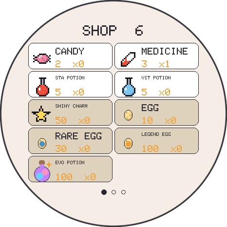<br>Shop</td><td align="center">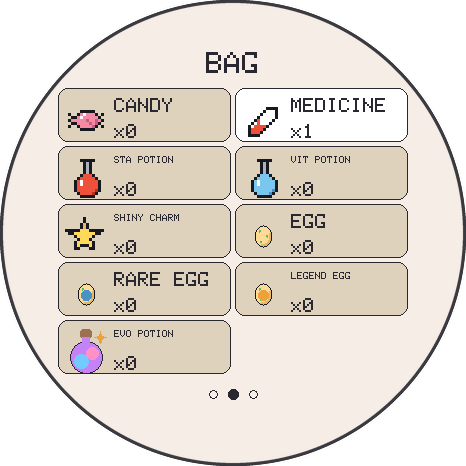<br>Bag</td><td align="center">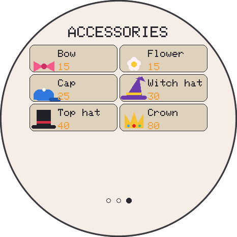<br>Accessories</td></tr></table>

### Pokédex, farm and album

- The 9 regions open in order: the next one opens once every common and rare
  species of the previous one has been registered. Eggs only bring species
  from open regions.
- The **farm** keeps companions you send there on the SD card. They keep
  growing at a tenth of the speed (without evolving), come back healthy, and
  sometimes walk across the main screen. Species in the farm don't come out of
  eggs or evolutions.
- The **album** keeps one page per companion that has left, with dates, level,
  medals and how it ended.
- A **backup** of the game is written to the SD once a day (Wi-Fi details are
  not included) and can be restored from settings.

<table><tr><td align="center">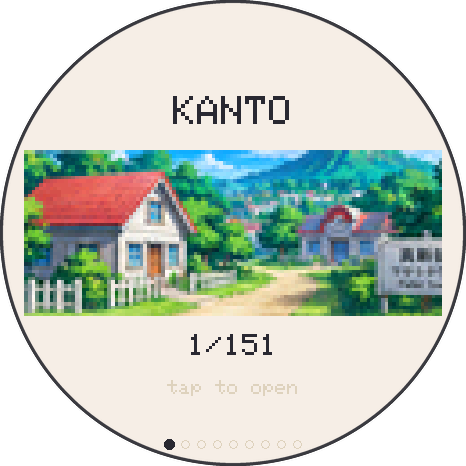<br>Region cover</td><td align="center">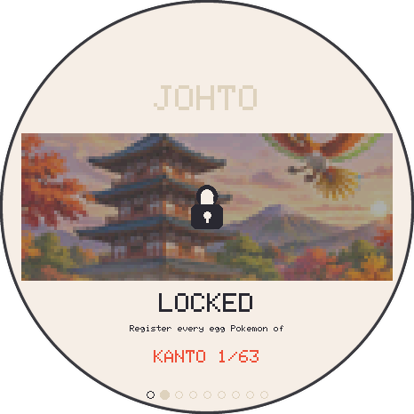<br>Locked region</td><td align="center">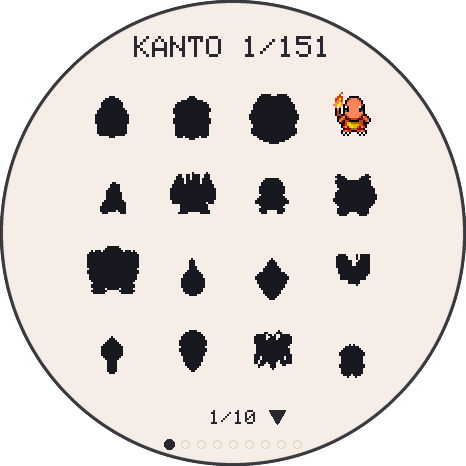<br>Region grid</td></tr></table>

<table><tr><td align="center">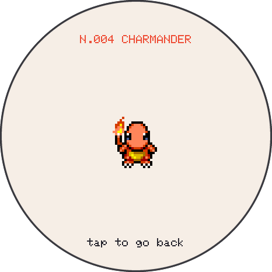<br>Pokédex entry</td><td align="center">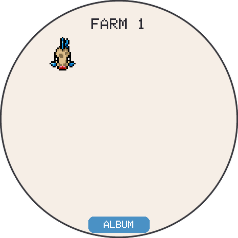<br>Farm</td><td align="center">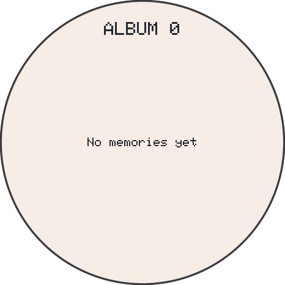<br>Album</td></tr></table>

### World and power

- Weather from Open-Meteo: every hour when plugged in, every 3 hours on battery
  (not between 00:00 and 06:00). Rain, snow, fog and storms show on screen and
  affect moods by type; sunrise and sunset drive day and night.
- Seasons, holidays (New Year, Lunar New Year, Lantern Festival, Valentine's,
  Easter, Mother's and Father's Day, Dragon Boat, Canada Day, Mid-Autumn,
  Thanksgiving, Halloween, Christmas) and a birthday (set over serial with
  `BDAY month day`).
- **Standby clock:** plugged in and untouched for 90 seconds, the screen shows
  a large clock with the date and weather.
- Time comes from NTP at boot and every hour.

### Stack-chan / xiaozhi (optional)

With a xiaozhi MCP endpoint saved and USB power, the board stays online as an
MCP server. A xiaozhi agent (for example on a Stack-chan) can then check the
pet's status and feed it, play with it, bathe it, put it to bed or wake it,
give candy or medicine, report chess points and Pokédex progress, buy cheap
items and list the farm.

## Development

```bash
./test/run_tests.sh            # host tests (C++)
python3 test/test_tools.py     # sketch and tool checks
python3 tools/test_i18n_formats.py
```

- Chinese font: `tools/make_zh_font.py` builds `zhfont.h` from the WenQuanYi
  BDF files in the U8g2 repository (`tools/font/bdf`), with only the characters
  that are actually drawn. Run it again after adding Chinese text.
- Region pictures: `tools/make_regions.py` builds `regions.h` and the `bgN.bin`
  backgrounds from `tools/assets/regions_source.png`.
- Pokédex data: generated from PokéAPI (`tools/gen_dex*.py`).
- Serial console at 115200 baud for debugging, for example `HEALTH`, `STATS`,
  `SHOT` (screen dump), `WX`, `SYNC`.
- Before publishing, `tools/privacy_check.py` scans what would be uploaded for
  the values in `config_private.h` and an optional local `.privacy_denylist`.
  It can run as a `pre-push` hook.

## Credits

- Original project: [socquique/TamaPoke](https://github.com/socquique/TamaPoke)
  by Quique Tortosa and contributors.
- Sprites: [PMD SpriteCollab](https://github.com/PMDCollab/SpriteCollab)
  (CC BY-NC 4.0; per-sprite credits in its `tracker.json`).
- Species data and names: [PokéAPI](https://pokeapi.co).
- Chinese font: WenQuanYi Bitmap Song, from the
  [U8g2](https://github.com/olikraus/u8g2) repository.
- Weather data by [Open-Meteo.com](https://open-meteo.com/) (CC BY 4.0).
- Chess data from the [chess.com Published-Data API](https://www.chess.com/news/view/published-data-api).
- Libraries: Arduino_GFX (moononournation), SensorLib and XPowersLib (Lewis
  He), U8g2 (olikraus), ArduinoJson (Benoît Blanchon), WebSockets (Markus
  Sattler).
- Region landscapes: AI-generated for this fork.

## License

- Code: MIT, see [LICENSE](LICENSE). This fork's changes are under the same
  license.
- Sprites (`tools/sdcard/mons`): CC BY-NC 4.0, from PMD SpriteCollab. Don't
  use them commercially.
- Upstream's 3D case on MakerWorld: CC BY-NC-SA.
- Pokémon names and characters belong to their owners.
