<div align="center">

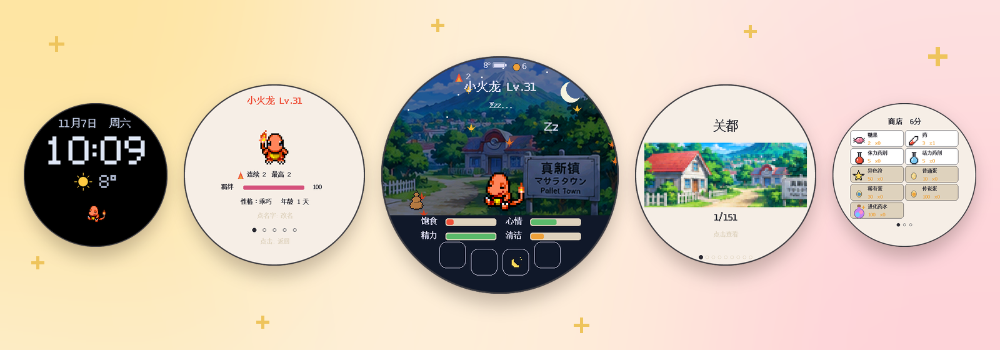

# TamaPoke with Chess

靠真实的 **chess.com** 国际象棋对局"过日子"的温和宝可梦电子宠物。<br>
下棋赚积分，给按天慢慢长大的伙伴买糖果、蛋和药剂。

[](#初衷)
[](https://mu-muu.github.io/TamaPoke/web/)
[](#和原项目的区别)
[](#硬件)
[](README.md)

**[chess.com 联动](#初衷)** · **[和原项目的区别](#和原项目的区别)** · **[硬件](#硬件)** · **[编译和刷机](#编译和刷机)** · **[怎么玩](#怎么玩)**

[English](README.md) · **简体中文**

<a href="https://mu-muu.github.io/TamaPoke/?lang=zh#build">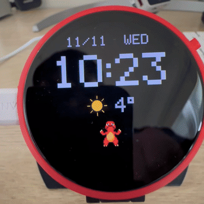</a>

</div>

**[项目网站](https://mu-muu.github.io/TamaPoke/?lang=zh)**：在浏览器里孵蛋、做一道棋题、跑一场比赛，还有一段[真机实拍视频](https://mu-muu.github.io/TamaPoke/?lang=zh#build)。第一次玩可以先看**[玩法教程](https://mu-muu.github.io/TamaPoke/guide/?lang=zh)**。

**[在浏览器里一键安装](https://mu-muu.github.io/TamaPoke/web/)**（电脑上用 Chrome 或 Edge，不用装 Arduino）。

一个宝可梦电子宠物，运行在 **Waveshare ESP32-S3-Touch-AMOLED-1.75**（466×466 圆形
AMOLED 触摸屏）上。本项目分叉自
[socquique/TamaPoke](https://github.com/socquique/TamaPoke) v1.18，改成了节奏更慢、
更温和的养成玩法：收录全部 **1025** 种宝可梦，界面支持英文和**简体中文**，没有对战，
宠物按天慢慢长大。

> **个人非商业同人项目。** 代码采用 MIT 许可；精灵图来自 PMD SpriteCollab
> （CC BY-NC 4.0）。宝可梦的版权属于任天堂 / Creatures / GAME FREAK / The Pokémon
> Company，本项目与这些公司无关，也未获得其认可。详见[致谢](#致谢)和[许可](#许可)。

## 初衷

这个分叉是为我女儿做的。她很喜欢国际象棋，但和所有孩子一样，有时也会懈怠、不想练。
所以我让这只宠物靠下棋"过日子"：她在 chess.com 上下的棋会变成积分，积分可以给她的伙伴买
糖果、药剂、蛋和装饰品。

**在 chess.com 下棋 → 板子每晚自动同步 → 积分买糖果、蛋和药剂 → 第二天早上宠物为昨天的对局欢呼。**

- 只有认真下的棋才算：基础时间 10 分钟以上的对局，或者每日对局。超快棋、闪电战和跟电脑
  下的都不算。赢一盘得 10 分，和棋 7 分，输了也有 5 分（输棋和赢棋一样能学到东西）；
  等级分、战术题、Puzzle Rush 创新高还有奖励，练得越多，回报越多。
- 其他来源（走路、农场收获）只给一点点积分，下棋始终是主要的收入。
- 基本照顾（喂食、玩耍、洗澡、睡觉）永远免费。不下棋不会让宠物受苦，下棋只会让它的生活
  更丰富。
- 板子每晚同步一次，第二天宠物会为昨天的对局欢呼（"昨天赢了 3 盘，好厉害！"）。
- 只读取一个用户名在 chess.com 上的公开数据（[公开数据 API](https://www.chess.com/news/view/published-data-api)），
  不用登录、不用密码，也从不往 chess.com 发送任何东西。
- 用户名在板子的 Wi-Fi 设置页里填写（见 [Wi-Fi](#wi-fi)），所以网页一键安装的版本也能拿象棋积分。
  自己编译固件的话，也可以在 `config_private.h` 里预先写好（见[个人设置](#个人设置)）。

## 和原项目的区别

| | 原项目 v1.18 | 本分叉 |
|---|---|---|
| 宝可梦 | 第 1 代（151 种） | 第 1-9 代（1025 种），图鉴每个地区一页 |
| 语言 | 8 种 | 英文 + 简体中文 |
| 成长 | 每小时升 1 级，按等级进化，有对战数值和小游戏 | 按天数进化，可超级进化一天，有性格、生病、能力，没有对战 |
| 锦标赛 | — | 和随机的两只宝可梦比十一个项目（跑道、泳池、跳跃、举重、攀岩、跳水、滑冰、火炬长跑、越野），看能力和属性自动比，不打架 |
| 道馆 | — | 每个地区 8 个道馆（共 72 个），和馆主及他们动画里的宝可梦三对三团体赛，徽章、四天王和冠军 |
| 趣玩 | — | 按属性果园、钓鱼、挖矿、寻宝；花下棋赚的积分，收获加训练值的果子、蛋和Mega石碎片 |
| 好友 | — | 两块板子放在一起「见面」成为好友：一起玩、送礼物、合影、一起比赛和打道馆；分开后还能串门、寄明信片和礼物（全程加密） |
| 自主行为 | — | 自己安排行动、冒对话气泡，插电没人管时会自己照顾自己 |
| 收集 | 图鉴、连续照顾天数、亲密度、奖章 | 另加农场、相册、统计页、装饰品 |
| 积分 | — | chess.com 下棋、走路步数（也可以从 iPhone 同步）、冰球练习、集齐地区奖励，在商店和趣玩里用 |
| 环境 | 地形和昼夜背景 | 真实天气、日出日落、季节、节日、地区风景 |
| 其他 | 电池管理、屏幕变暗、网页刷机 | 另加待机时钟、联网校时、SD 卡备份（每天自动，也能随时手动），可选 Stack-chan 控制 |

## 硬件

- [ESP32-S3-Touch-AMOLED-1.75](https://www.waveshare.com/wiki/ESP32-S3-Touch-AMOLED-1.75)
  （标准版或 -G 版。原项目提醒："-B" 版自带外壳，装不进去；"1.75C" 是另一块板子）。
- 一张 microSD 卡（FAT32），存放精灵图、农场、相册和备份。
- 可选：3.7 V 锂电池，MX1.25 插头（先确认正负极）；一个小喇叭，接在 MX1.25 喇叭接口上。
- 可选：原项目的 3D 打印精灵球外壳
  （[MakerWorld](https://makerworld.com/es/models/2937822-tamapoke-a-pokemon-pokeball-tamagotchi)），
  另需 3 颗 M2×5 自攻螺丝和 6 颗 6×2 mm 磁铁。

## 编译和刷机

Arduino 开发板包 **esp32 3.3.x**（在 3.3.10 上测试过），以及下面这些库（括号里是测试过的版本）：

| 库 | 版本 | 用途 |
|---|---|---|
| GFX Library for Arduino | 1.6.9 | QSPI 驱动 CO5300 屏幕，帧缓冲放在 PSRAM |
| SensorLib | 0.5.1 | CST9217 触摸、PCF85063 时钟、QMI8658 运动传感器 |
| XPowersLib | 0.3.3 | AXP2101 电源管理和 PWR 键 |
| U8g2 | 2.36.19 | 字体支持 |
| ArduinoJson | 7.4.3 | chess.com、Open-Meteo、MCP |
| WebSockets（Markus Sattler） | 2.7.2 | Stack-chan / 小智 MCP |

开发板设置：**ESP32S3 Dev Module**，Flash **16MB**，PSRAM **OPI**，分区
**16M Flash (3MB APP/9.9MB FATFS)**，USB CDC On Boot **Enabled**。

```bash
FQBN="esp32:esp32:esp32s3:CDCOnBoot=cdc,FlashSize=16M,PSRAM=opi,PartitionScheme=app3M_fat9M_16MB"
arduino-cli compile --fqbn "$FQBN" --output-dir build .
arduino-cli upload --fqbn "$FQBN" -p /dev/cu.usbmodemXXXX --input-dir build .
```

也可以不编译，直接用[网页安装](https://mu-muu.github.io/TamaPoke/web/)：在 Chrome 或 Edge
里刷入本分叉。它用的是通用设置（界面英文，可在设置里切成中文；时间和天气按板子联网后自动定位到的
地点，也可以在 Wi-Fi 设置页填城市）；要象棋积分，在同一页填上 chess.com 用户名就行。SD 卡文件是
[最新发布版本](https://github.com/Mu-Muu/TamaPoke/releases/latest)里的 `tamapoke-sd.zip`。

### 个人设置

主人名字、chess.com 用户名、天气坐标和时区写在 `config_private.h` 里，这个文件不会被
git 上传（Wi-Fi 设置页里填的城市和用户名优先）。把 [`config_private.example.h`](config_private.example.h) 复制成
`config_private.h` 再填写。没有这个文件时，固件使用 [`config.h`](config.h) 里的中性
示例值（地点按网络自动定位，chess.com 用户名只能在 Wi-Fi 设置页填）。

| 设置 | 作用 |
|---|---|
| `OWNER_NAME` | 几句台词里用到的名字（"最喜欢……了！"、生日祝福），最多 16 字节 |
| `CHESS_USER` | 默认的 chess.com 用户名；Wi-Fi 设置页里填的优先；留空就只用设置页里填的 |
| `WX_LAT`、`WX_LON`、`WX_TZ` | 天气的地点和 IANA 时区（`/` 写成 `%2F`）；不填（设置页也没填城市）时，板子按网络自动定位 |
| `LOCAL_TZ` | 联网校时用的 POSIX 时区字符串 |
| `TZ_STD_OFFSET_H`、`TZ_DST_NA` | 标准时间相对 UTC 的小时数，以及是否按美国/加拿大规则实行夏令时（地点来自设置页或自动定位时不用这两项：时钟改用 Open-Meteo 给的该地当前时差，已含夏令时） |
| `MAILBOX_URL`、`MAILBOX_KEY` | 和好友远程寄信用的信箱；默认 ntfy.sh，不用填。用自己的 Cloudflare Worker 时填它的地址和口令（见下面「好友」一节） |

### SD 卡

把 [`tools/sdcard/mons`](tools/sdcard/mons) 文件夹复制到卡的根目录，让文件位于
`/mons/` 下（约 290 MB：普通和异色精灵图、图鉴缩略图、9 张地区风景）。
`python3 tools/send_sd.py` 也能通过 USB 传过去，但整套传完很慢。

**如果卡无法挂载，固件会把它格式化。** 请先备份卡里的东西。

### Wi-Fi

在设置页点 **Wi-Fi**，板子会开一个叫 `TamaPoke` 的热点。用手机连上后打开
`192.168.4.1`（页面语言跟板子的界面语言一致），填入 Wi-Fi 名称和密码，最多三个（比如家里、
学校和手机热点，板子会连能看到的、信号最强的那个；只支持 2.4 GHz，iPhone 热点要打开
"最大兼容性"），也可以填城市和 chess.com 用户名。城市决定时钟的时区（含夏令时）和天气的地点；
有重名的城市，可以在逗号后面加上省、州或国家（`Springfield, IL`、`Lyon, France`）。板子下次联网时用
[Open-Meteo](https://open-meteo.com/en/docs/geocoding-api) 查找，屏幕上会提示"城市已更新"
（或"没查到这个城市"），再打开设置页就能看到它找到的是哪里。不填城市时，`config_private.h` 里没写地点的板子
（比如网页安装的版本）会在联网后用 [ipapi.co](https://ipapi.co/) 按网络自动定位（这个服务能看到板子的公网
IP，和板子访问的其他网站一样）。时钟按保存这个页面的手机的时区走（页面从手机设置里读出来），因为网络运营商的
出口可能很远，甚至在另一个时区；这种情况下，天气改用手机时区所指的城市（`America/Chicago` → Chicago）。开了
VPN 或用某些手机热点时地点可能不准，这时在这里填的城市优先。
最后一栏 **Stack-chan 语音控制** 只有 Stack-chan 或其他小智语音设备才需要
（见 [Stack-chan / 小智](#stack-chan--小智可选)），没有就留空。这些信息只保存在板子上，
之后不会再显示（页面只标出哪几个 Wi-Fi 已经存过，以及找到的城市）。不改的项留空即可；填一个减号 `-` 会删掉
某个 Wi-Fi（填在它的名称里）、城市（回到默认地点或自动定位）、用户名或语音控制地址。换了用户名后，
下一次同步只记录新账号当前的成绩。

## 怎么玩

### 界面

在主屏幕上：

| 操作 | 打开 |
|---|---|
| 向**右**滑 | 图鉴：每个地区一张封面，继续滑换地区；点封面进入该地区的列表（上下滑翻页，点某只看详情） |
| 向**左**滑 | 活动：农场（底部有相册按钮）、锦标赛、道馆和趣玩 |
| 向**上**滑 | 宠物卡片：资料、能力、奖章（左右滑翻页） |
| 向**下**滑 | 设置：时钟、温度单位（°C/°F）、声音（大声、中等、小声或关）、Wi-Fi、语言、备份（立即备份或恢复）、统计、屏幕亮度（三档）、立即同步象棋 |
| 点顶部的**积分** | 商店（道具、蛋、装饰品） |
| **长按**宠物 | 送去农场，或放生 |

底部按钮：**喂食**（树果、糖果、药）、**玩耍**、**开关灯**（睡觉 / 起床）、**洗澡**（顺便清理便便）。

和宠物互动：点一下是摸摸它，来回划是抚摸，双击会让它跳一下，可以戳头或戳肚子，挠痒痒
（挠太多它会烦），拖着它走，画圈让它转圈。把板子倾斜，它会往低处走；屏幕朝下放，它会
睡觉；用力摇晃，它会头晕。

<table><tr><td align="center">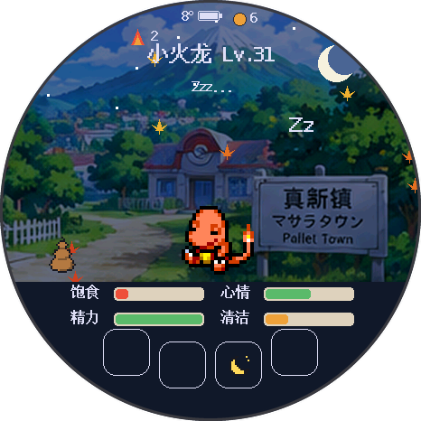<br>主屏幕（夜里睡着了）</td><td align="center">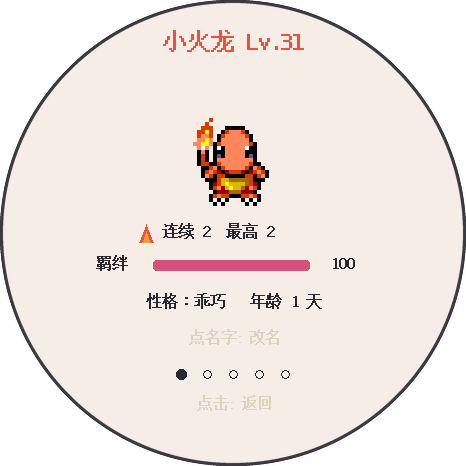<br>宠物卡片</td><td align="center">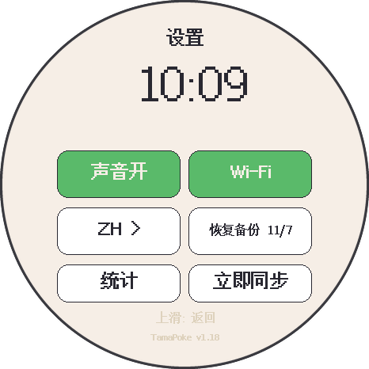<br>设置</td></tr></table>

<table><tr><td align="center">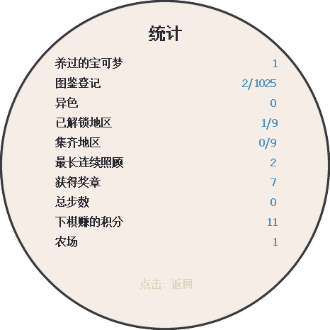<br>统计</td><td align="center">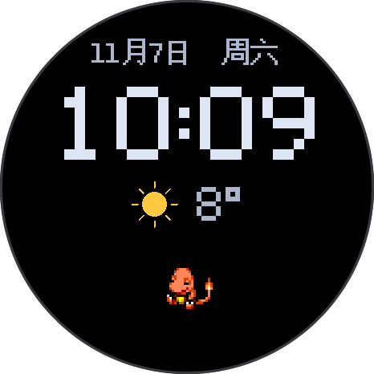<br>待机时钟</td></tr></table>

<table><tr><td align="center"><br>活动（向左滑）</td></tr></table>

### 照顾

- 四项需求，每项 0 到 100：饱食、心情、精力、清洁。醒着时每分钟下降，睡着时慢很多。
  便便会拉低清洁。
- 任何一项降到 10 或以下，算一次**照顾失误**（每小时最多算一次）。便便有两坨以上、
  太胖，或者任何一项降到 20 或以下，都可能让它**生病**：要喂药，否则生病期间每 2 小时
  算一次失误。如果它醒着病了 10 分钟，会自己从背包里拿药吃。它从不花你的积分：背包里没有药，
  就会一直病着，等你喂药。
- 四项全部为 0 并持续一小时，会出现"逃走"按钮。
- **夜里：** 如果灯还开着，它会在 23:00 自己睡着，07:00 醒来。用 PWR 键关掉屏幕，它也会去睡；
  这时只有再按一下 PWR 键才能重新点亮，碰屏幕没反应，放在口袋里不会被蹭亮（如果是屏幕朝下关掉的，
  翻回正面也会亮）。
- **用电池时：** 5 分钟没人碰，屏幕会自己关掉，它也跟着去睡，和按了 PWR 键一样，
  所以你不在的时候它的状态基本不掉。要叫醒它就按 PWR 键。插着电时屏幕不会关，而是显示待机时钟。
- **自己照顾自己：** 插着电、10 分钟没人碰时，它会把低于 40 的需求补到 50，每分钟补一项，
  这段时间里也不会生病。整个过程是静默的：没有动画，没有声音，屏幕上还是待机时钟。这不算你的照顾。
- **性格**（孵化时随机）：乖巧、贪吃、爱玩、爱干净、懒洋洋。某一项需求会掉得稍快，
  它喜欢的那种照顾效果也更好。

<table><tr><td align="center"><br>喂食</td><td align="center"><br>洗澡</td><td align="center"><br>摸摸头</td></tr></table>

### 成长

- 进化看**天数**，所有进化链都一样：第一次在第 3 天，第二次在第 5 天。每次照顾失误推迟
  2 小时，而且四项需求都要在 40 以上。时间到了会出现按钮，可以选择进化，也可以保持现在的
  样子。**进化药水**（100 积分）能省掉要等的天数，但四项需求仍要在 40 以上。
- 最终形态满 **7 天**后它会想去农场养老（你可以选择再陪它一段时间）。之后它会住进**农场**，
  随时可以换回来；回忆录里会留一页，然后你可以开一个新蛋。
- **能力**（0-100，没有对战）：力量（力量药剂）让精力最多慢一半下降；速度（速度药剂）让
  心情最多慢一半下降；耐力在连续好好照顾时每 3 小时加 1（白天关屏也算，晚上睡觉和关灯时暂停），最多让生病的几率降低 60%。
  耐力药剂不卖：在主屏幕的草丛和趣玩的寻宝里得到，放在背包的“收获”页。
  在锦标赛和道馆里，各自帮对应的种族能力：力量帮攻击，速度帮速度，耐力帮 HP 和防御。

<table><tr><td align="center">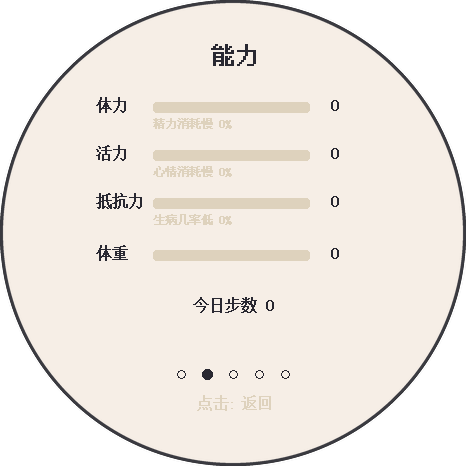<br>能力</td><td align="center">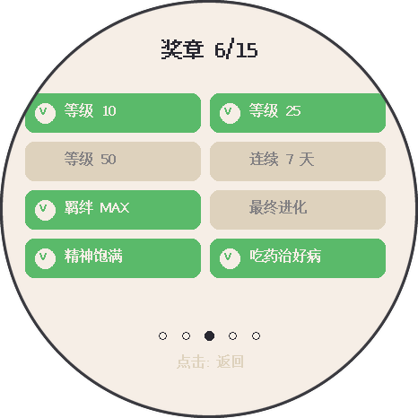<br>奖章</td></tr></table>

### 积分和商店

开局有 10 积分。基本照顾都是免费的。

- **chess.com**（在 Wi-Fi 设置页或 `CHESS_USER` 里设了用户名才有）：每天午夜同步一次，
  错过时在下次开机同步，也可以
  点**立即同步**。基础时间 10 分钟以上的对局或每日对局：赢一盘得 10 分，和棋 7 分，输棋 5 分；
  没有计时的对局（和电脑下）不算。快棋或每日棋创新高得 20 分，快棋每突破一个新的百位整数得 50 分，
  战术题或 Puzzle Rush 创新纪录得 10 分。第一次同步（以及换了用户名后的第一次）
  只记录你当前的成绩，不补发以前的分。
- **走路步数**（用加速度计识别，关屏时也算，长按电源键关机后不算）：每 1000 步 1 分，
  每天最多 5 分；当天走满 1 万步再加 10 分。iPhone 也可以把自己的步数发过来（见
  [从 iPhone 同步步数](#从-iphone-同步步数)），取两边较多的那个。
- 集齐一个地区的图鉴：200 分、一顶皇冠，以及一个该地区的异色传说蛋。
- 每天 07:00 后农场有一点小收获。
- **家长加分**：家长用 iPhone 给孩子加分，奖励什么都行（做家务、读书、表现好），每天最多 20 分
  （见[家长用 iPhone 加分](#家长用-iphone-加分)）。

| 道具 | 积分 |
|---|---|
| 糖果（加心情和饱食，但会变胖） | 2 |
| 药 | 3 |
| 力量药剂 / 速度药剂 | 各 5 |
| 进化药水 | 100 |
| Mega石（锦标赛拿金牌也送，每天一颗） | 150 |
| 异色护符 | 50 |
| 普通蛋 / 稀有蛋 / 传说蛋 | 10 / 30 / 100 |
| 装饰品（蝴蝶结、小花、棒球帽、巫师帽、礼帽、皇冠） | 15-80 |

只有在没有搭档时才能开蛋。在商店里继续向左滑依次是背包、**收获**（[趣玩](#趣玩)得到的东西）、饰品，最后是积分本。

<table><tr><td align="center">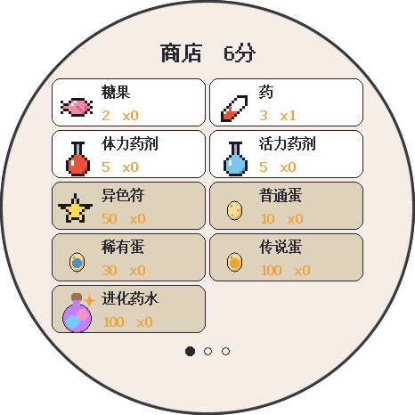<br>商店</td><td align="center">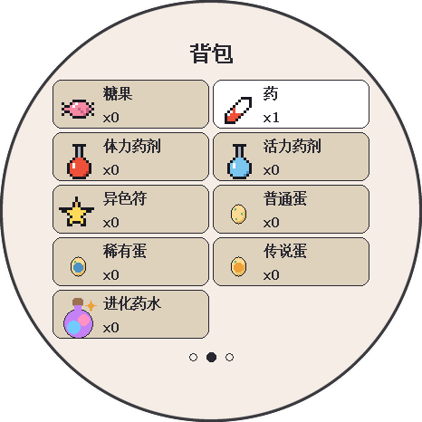<br>背包</td><td align="center">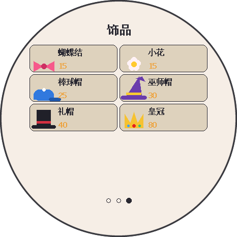<br>装饰品</td></tr></table>

买东西会先问一下（是 / 否），[趣玩](#趣玩)里要花积分的动作也一样。

**积分本**在商店的最后一页（也可以点商店顶部的积分）：本周每天赚了（绿）和花了（橙）多少，从哪来（下棋、走路、冰球、家长加分、其他）、花在哪（商店、趣玩），还有上周的对比。每周一主屏会弹出上周积分小结。

<table><tr><td align="center"><br>买之前先确认</td><td align="center"><br>积分本</td></tr></table>

### 草丛彩蛋

主屏幕地上有时会有一丛草在晃，点一下就能找到藏在里面的东西。每天一个（两颗糖果、一颗药、
一瓶药剂或一个普通蛋），每周一个（从周一算起；稀有蛋、异色符或两瓶药剂：一瓶耐力药剂，再加一瓶力量或速度药剂，草丛闪蓝光），
每月一个（传说蛋、Mega石或进化药水，草丛闪金光）。同时有好几个时，先出最值钱的那个。
彩蛋不送积分。

<table><tr><td align="center"><br>晃动的草丛</td></tr></table>

### 图鉴、农场和相册

- 9 个地区按顺序开放：上一个地区里所有普通和稀有的宝可梦都登记后，下一个地区才开放。
  蛋里只会孵出已开放地区的宝可梦。
- **农场**把你送过去的伙伴存在 SD 卡上。它们会以十分之一的速度继续长大（但不会进化），
  接回来时是健康的，偶尔还会走到主屏幕上来串门。农场里已有的种类不会再从蛋里孵出，也不会
  通过进化得到。
- **相册**为每位离开的伙伴留一页，记录日期、等级、奖章和它离开的方式。
- 游戏进度每天**备份**到 SD 卡一次（不包括 Wi-Fi 信息）。在设置里点**备份**，可以随时存一份新的（**立即备份**），
  也可以把备份恢复回来（**恢复备份**），两种操作都会先问一下。
- **换一块板子：** 先在旧板子上点立即备份，再把它的 SD 卡插到新板子上（卡里还有农场、相册和好友合影）。
  给新板子刷机，随便选一只初始宝可梦，连上 Wi-Fi 让时钟校准，然后点恢复备份。确认新板子没问题后，
  用网页安装器把旧板子清空，免得两块板子共用一份存档。

<table><tr><td align="center">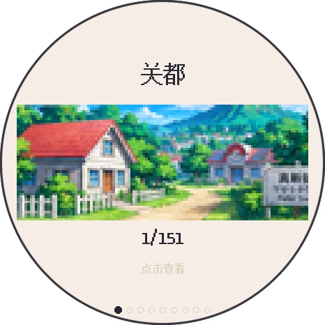<br>地区封面</td><td align="center">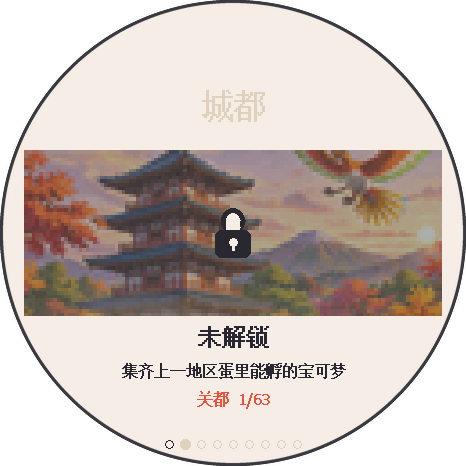<br>未开放的地区</td><td align="center">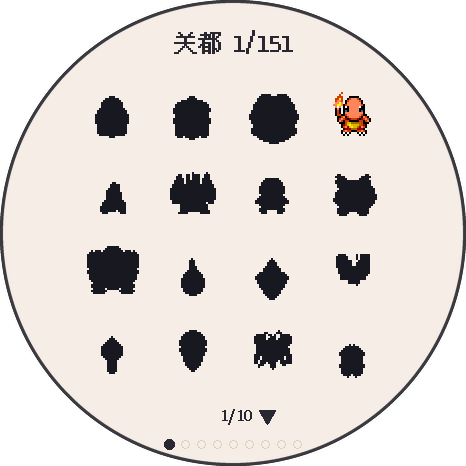<br>地区列表</td></tr></table>

<table><tr><td align="center">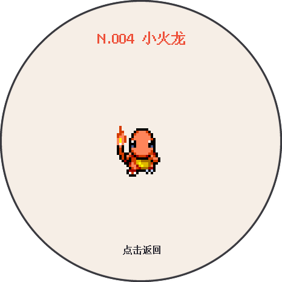<br>图鉴详情</td><td align="center">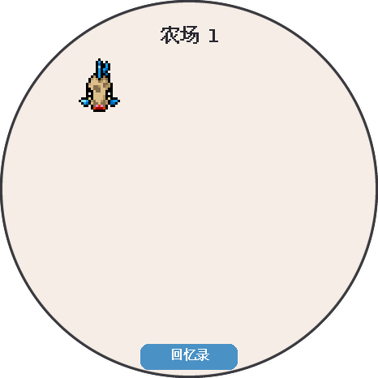<br>农场</td><td align="center">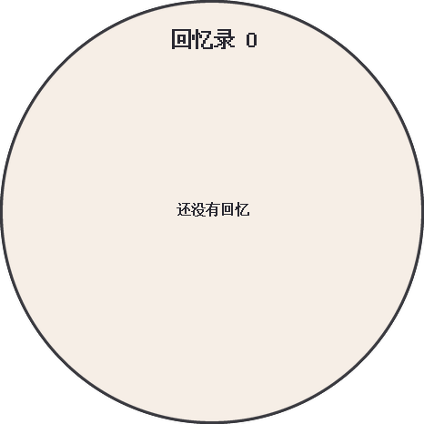<br>相册</td></tr></table>

### 锦标赛

在主屏幕向左滑，点**锦标赛**，再从十一个项目里选一个。你的伙伴和随机抽到的两只宝可梦比赛，每个项目
有自己的场地。不用点屏幕，也不打架，比赛自己进行。

成绩看每只宝可梦本身：种族能力（每个项目看重的能力不同）、个体基因和训练、进化阶段、
超级进化（+15%）和属性。对手的基因和训练是随机的，每场还有一点运气，所以最强的也不一定每次赢。

| 项目 | 比什么 | 属性加成 | 场地 |
|---|---|---|---|
| 100米短跑 | 速度 | 电 +15%、格斗 +10%（岩石、钢 -10%） | 有看台的跑道 |
| 跨栏 | 速度和弹跳 | 格斗 +15%、虫 +10%（岩石、钢 -10%） | 摆着栏架的跑道 |
| 50米游泳 | 速度和耐力 | 水 +25%、冰 +10%（火、岩石 -15%） | 有分道线的泳池 |
| 跳远 | 力量和速度 | 格斗、飞行 +15%（岩石、钢 -10%） | 助跑道、起跳板和沙坑 |
| 跳高 | 力量 | 飞行 +25%、超能力 +15%（岩石、钢 -15%） | 横杆和软垫 |
| 举重 | 力量和稳定 | 格斗 +20%、钢、岩石 +15%（飞行、妖精、虫 -10%） | 打着聚光灯的举重台 |
| 攀岩 | 力量和速度 | 岩石 +20%、地面 +15%、虫 +10%（水、钢 -10%） | 攀岩墙 |
| 跳水 | 技巧 | 水 +20%、超能力、飞行、妖精 +10%（火、岩石 -15%） | 跳台和泳池 |
| 速度滑冰 | 速度 | 冰 +25%、妖精 +10%（火 -15%） | 冰场 |
| 火炬长跑 | 耐力 | 火 +25%、龙 +10%（水、冰 -10%） | 城市公路 |
| 越野障碍 | 什么都比一点 | 恶、幽灵 +15%、毒、草 +10%（钢、岩石 -10%） | 摆着圆木的林间小路 |

拿到金牌伙伴会很开心，每天第一块金牌还送一颗**Mega石**。比赛会消耗一点精力；
睡觉、生病或太累时不能参加。

<table><tr><td align="center"><br>锦标赛</td><td align="center"><br>火炬长跑</td><td align="center"><br>领奖台</td></tr></table>

### 道馆

在主屏幕向左滑，点**道馆**。每个地区 8 个道馆（一共 72 个），馆主和徽章都用原作的，每位
馆主带三只他在动画里用过的宝可梦。道馆比的还是运动，不打架：每个道馆按自己的属性挑最拿手的
三个项目，三对三团体赛。

- 你的队伍是伙伴加上从农场挑的两只（农场里至少要有两只）。开始前可以调整谁比哪个项目；
  馆主会把自己的宝可梦排在最拿手的项目上。
- 每个项目一对一，三局两胜，赢了就拿到徽章。
- 道馆跟着地区一起开放，要按顺序挑战：拿到上一枚徽章才能挑战下一个。每个道馆每天只能挑战一次。
- 越往后越难：馆主宝可梦的基因和训练越来越好。
- 每个地区的第 2、4、6 枚徽章还送稀有蛋，第 8 枚送传说蛋。
- 集齐 8 枚徽章后开放这个地区的**联盟大赛**：先四天王、再冠军，一个接一个比（每天一次）。
  第一次夺冠送传说蛋和异色符。

道馆列表也是徽章盒：左右滑换地区。

<table><tr><td align="center"><br>道馆和徽章</td><td align="center"><br>一个道馆</td><td align="center"><br>排阵容</td></tr></table>

### 趣玩

在主屏幕向左滑，点**趣玩**。一共四种玩法，每个属性都有一种可以玩。伙伴属性对得上（而且醒着、没生病、
不太累）就由伙伴去；不然就从农场里挑一只属性对的去，所以收集不同属性的宝可梦很有用。

| 玩法 | 属性 | 花费 | 怎么玩 | 收获 |
|---|---|---|---|---|
| 果园 | 草、虫、地面、毒、妖精 | 每块地 8 分 | 3 块地，按真实时间长：种下、浇一次水（浇了 12 小时熟，不浇 24 小时），熟了收获 | 2–3 个果子 |
| 钓鱼 | 水、冰、龙 | 5 分 | 抛竿，浮漂沉下去时点屏幕收竿 | 鱼、珍珠，偶尔钓到水属性蛋 |
| 挖矿 | 岩石、钢、格斗、火 | 10 分 | 一直点石头直到敲开 | Mega石碎片（10 片合成 1 颗），有时是化石蛋 |
| 寻宝 | 一般、飞行、电、超能力、幽灵、恶 | 8 分 | 出门 1 小时，回来后领取 | 糖果、药、药剂、饰品，极少数时候是异色符 |

趣玩**只花积分，不产生积分**：积分还是靠下棋。当天下棋还会带来好运：下过棋，每种玩法都多收获 1 个；
赢过棋，稀有东西的概率翻倍。

- **果子**加训练值：力量果、耐力果、速度果各 +3，金果三项都 +3、心情加满。每只宝可梦每天最多 3 个
  果子能加能力（再吃只是填饱肚子）。训练值对锦标赛和道馆都有帮助；农场里的宝可梦也能吃（在农场点开它，
  上面一排果子点一下就喂），因为道馆队友用的是它们自己的训练值。
- **鱼**能吃得很饱，**珍珠**让它特别开心。有鱼和果子时，主屏的**喂食**菜单会多一排，可以直接喂。
- 伙伴出门寻宝时，主屏幕上会挂一块牌子，写着还要多少分钟回来。

<table><tr><td align="center"><br>趣玩</td><td align="center"><br>果园</td><td align="center"><br>钓鱼</td></tr></table>

### 好友：见面和寄信

和朋友各有一块板子时，可以成为好友一起玩。在主屏幕向左滑，点**好友**：上面是**见面**，下面是好友列表。两块板子都要刷这一版或更新的固件。

**见面（两块板子放在一起）**：两人同时打开**见面**，板子会找到靠得很近的对方。点一下对方，两边都同意后，
两块屏幕会显示同一个 4 位数，核对一样就成了好友。见面页开着时，两块板子用无线电直接连接（ESP-NOW），
家里的 Wi-Fi 先暂停，关掉页面或 3 分钟没操作就恢复。

好友就在旁边时可以：

- **一起玩**：两只宝可梦一起跑、接球、跳舞；两人同时点自己的宝可梦，它们会击掌。
- **送礼物**：从背包里挑一样，对方收下才送出，不收就退回背包。
- **一起比赛、打道馆**：锦标赛里再加一只随机对手；道馆由邀请的一方出两只，好友的伙伴当第三只。
- **合影**：每个好友每天第一次见面时拍一张，存在 SD 卡里，在好友页里看。图鉴里也会标出好友养过的宝可梦（不算自己养过）。

**寄信（不在一起时）**：见过一次面以后，就能在好友列表里给对方：

- **串门**：伙伴去对方的屏幕上打个招呼，待几分钟。
- **明信片**：挑一只宝可梦当信使（伙伴或农场里的），从 12 句话和 8 张图里各选一个。
- **礼物**：背包里的一样东西，寄出时从背包里扣掉。

信件在下次同步时送到：插着电时每 15 分钟同步一次，用电池时跟天气一起更新，也可以点**立即收发**。信使会走到好友的
主屏幕上，拿着信封或礼物盒等对方点开，礼物直接进背包。对方的板子确认收到之前，每 4 小时重寄一次；礼物 14 天还没送到
就退回背包。见面和寄信都**不产生积分**。

寄信要经过网上的一个信箱，默认是 [ntfy.sh](https://ntfy.sh)（免费，不用注册）。内容都用两人配对时生成的密钥加密并签名，
信箱只看得到乱码。也可以用自己的信箱：按 [`tools/mailbox-worker`](tools/mailbox-worker/README.md) 部署一个免费的
Cloudflare Worker，再在 `config_private.h` 里设置 `MAILBOX_URL` 和 `MAILBOX_KEY`。好友认的是存档而不是板子，
存档搬到另一块板子上，好友照样认得。

<table><tr><td align="center"><br>好友</td><td align="center"><br>见面</td><td align="center"><br>好友就在旁边</td></tr></table>

<table><tr><td align="center"><br>一起玩</td><td align="center"><br>信使送信来了</td><td align="center"><br>明信片</td></tr></table>

### 超级进化

在背包里用一颗**Mega石**：PMD SpriteCollab 里有超级进化素材的 41 种宝可梦（喷火龙 X、
超梦 Y、耿鬼、路卡利欧、烈空坐……）会超级进化 24 小时，然后变回来。伙伴没有超级进化时，
石头不会被用掉。素材是 SD 卡里的 `mons/mNNN.bin`（`tools/pack_pmd.py mega` 生成）。

### 从 iPhone 同步步数

板子可以读取 iPhone「健康」里当天的步数（板子留在家里时很有用）。板子要插着电、连着家里
的 Wi-Fi，手机在同一个网络。配对码在统计页（设置 → 统计 →「手机步数配对码」）。

在「快捷指令」App 里：自动化 → 新建自动化 → **特定时间**（比如每天 21:00）→ 立即运行，
加上这些操作：

1. **查找健康样本**：类型是**步数**，开始日期是**今天**。
2. **计算统计数据**：健康样本的**总和**。
3. **获取 URL 内容**：`http://tamapoke.local/steps?n=` + 总和 + `&k=` + 你的配对码。

第一次运行时 iOS 会问是否允许访问本地网络，选允许。手机锁屏时读不到健康数据，所以选一个
手机平时在用的时间（也可以手动点一下运行）。板子取手机和自己计步中较多的那个，不会重复算。

连续输错 5 次配对码后，板子 5 分钟内拒绝所有请求（填对也不行），这样同一网络里的其他设备没法把 9000 个码挨个试一遍。

### 从 iPhone 记录冰球练习

再做一个快捷指令，练完冰球（SuperDeker 或别的都行）报一下练了几分钟：**每 5 分钟 1 分，每天最多 6 分**。
一天练几次会累计，主屏会显示今天练了多少分钟、得了几分，积分本里也有「冰球」一项。快捷指令放在
家长的手机上，积分才可靠。

在「快捷指令」App 里新建一个快捷指令，加上这些操作：

1. **请求输入**：类型选**数字**，提示写「练了几分钟冰球？」。
2. **获取 URL 内容**：`http://tamapoke.local/hockey?min=` + 提供的输入 + `&k=` + 你的配对码（和步数用同一个）。
3. **显示结果**（可选）：板子会回复 `{"ok":true,"min":15}`。

条件和同步步数一样：板子插着电，手机连着家里的 Wi-Fi。

### 家长用 iPhone 加分

第三个快捷指令让家长给孩子加分，奖励什么都行（做家务、读书、表现好）：**每次 1 到 10 分，每天最多 20 分**。
板子会亮屏，显示「家长加分」和分数，积分本里也有「家长」一项。快捷指令放在家长的手机上。

在「快捷指令」App 里新建一个快捷指令，加上这些操作：

1. **请求输入**：类型选**数字**，提示写「加几分？（1-10）」。
2. **获取 URL 内容**：`http://tamapoke.local/reward?pts=` + 提供的输入 + `&k=` + 你的配对码（和步数用同一个）。
3. **显示结果**（可选）：板子会回复 `{"ok":true,"pts":5}`。

条件和同步步数一样：板子插着电，手机和板子连着同一个 Wi-Fi。

### 环境和电源

- 天气来自 Open-Meteo：插电时每小时更新一次，用电池时每 3 小时一次（00:00 到 06:00 不更新）。
  雨、雪、雾、雷暴会显示在屏幕上，并按宠物的属性影响心情；日出日落决定白天和黑夜。
- 季节、节日（元旦、春节、元宵、情人节、复活节、母亲节、父亲节、端午、加拿大国庆、中秋、
  感恩节、万圣节、圣诞节）和生日（通过串口用 `BDAY 月 日` 设置）。
- **待机时钟：** 插着电、90 秒没人碰时，屏幕会显示大时钟，以及日期和天气。
- 开机时和之后每小时通过网络校准时间。

<table><tr><td align="center"><br>雪夜</td><td align="center"><br>圣诞节</td><td align="center"><br>万圣节</td></tr></table>

### Stack-chan / 小智（可选）

板子不直接和机器人或大模型说话：Stack-chan（以及其他小智设备）背后是小智语音服务，
小智给每个智能体开了一个 MCP 接入点，外部工具可以连进去。在语音助手 App 的 MCP 页面复制
这个地址（形如 `wss://api.xiaozhi.me/mcp/?token=...`），填到 Wi-Fi 设置页的
**Stack-chan 语音控制**一栏。智能体用哪个大模型（千问、DeepSeek……）都没有关系。

保存了这个地址并插着 USB 电源时，板子会一直在线，作为 MCP 服务器。小智的智能体
（比如 Stack-chan 上的）可以查看宠物状态，喂食、陪玩、洗澡、哄睡或叫醒，喂糖果或药，
查询下棋积分和图鉴进度，买便宜的道具，以及列出农场里的宝可梦。

## 开发

```bash
./test/run_tests.sh            # 电脑上跑的 C++ 测试
python3 test/test_tools.py     # 程序和工具的检查
python3 tools/test_i18n_formats.py
```

- 中文字库：`tools/make_zh_font.py` 用 U8g2 仓库（`tools/font/bdf`）里的文泉驿 BDF 文件
  生成 `zhfont.h`，只保留实际会显示的字。新增中文文字后要重新运行。
- 地区图片：`tools/make_regions.py` 根据 `tools/assets/regions_source.png` 生成 `regions.h`
  和背景文件 `bgN.bin`。
- 图鉴数据：由 PokéAPI 生成（`tools/gen_dex*.py`）。
- 调试用的串口控制台，波特率 115200，比如 `HEALTH`、`STATS`、`SHOT`（截屏）、`WX`、`SYNC`。
- 发布前，`tools/privacy_check.py` 会检查要上传的内容里有没有 `config_private.h` 里的值，以及
  本地可选的 `.privacy_denylist` 里的词。它可以作为 `pre-push` 钩子自动运行。
- 网站：`website/` 是一个 Next.js 静态站点（`npm ci && npm run build`，产物在 `website/out`）。
  Website 工作流会把它和安装页（`web/`）一起发布到 GitHub Pages。网站里的锦标赛用的是
  `sport.h` 的移植版：改了 `sport.h` 之后，运行 `bash website/scripts/check-sport.sh` 核对两边是否一致。
- 只改 `website/`、`web/`、`docs/` 或 Markdown 文件的提交不会触发 CI。

## 致谢

- 原项目：[socquique/TamaPoke](https://github.com/socquique/TamaPoke)，作者 Quique Tortosa
  及其他贡献者。
- 精灵图：[PMD SpriteCollab](https://github.com/PMDCollab/SpriteCollab)（CC BY-NC 4.0，
  每张图的作者见其 `tracker.json`）。
- 宝可梦数据和名字：[PokéAPI](https://pokeapi.co)。
- 中文字体：文泉驿点阵宋体，取自 [U8g2](https://github.com/olikraus/u8g2) 仓库。
- 天气数据由 [Open-Meteo.com](https://open-meteo.com/) 提供（CC BY 4.0）。
- 象棋数据来自 [chess.com 公开数据 API](https://www.chess.com/news/view/published-data-api)。
- 库：Arduino_GFX（moononournation）、SensorLib 和 XPowersLib（Lewis He）、U8g2（olikraus）、
  ArduinoJson（Benoît Blanchon）、WebSockets（Markus Sattler）。
- 地区风景图：为本分叉用 AI 生成。

## 许可

- 代码：MIT，见 [LICENSE](LICENSE)。本分叉的改动采用同样的许可。
- 精灵图（`tools/sdcard/mons`）：CC BY-NC 4.0，来自 PMD SpriteCollab，不可商用。
- 原项目在 MakerWorld 上的 3D 外壳：CC BY-NC-SA。网站上的 3D 模型
  （`website/public/models/tamapoke_case.glb`）由它制作，采用同样的许可，见
  [website/case3d](website/case3d/README.md)。
- 宝可梦的名字和角色归其权利人所有。
