# TamaPoke — 分叉版

[English](README.md) · **简体中文**

一个宝可梦电子宠物，运行在 **Waveshare ESP32-S3-Touch-AMOLED-1.75**（466×466 圆形
AMOLED 触摸屏）上。本项目分叉自
[socquique/TamaPoke](https://github.com/socquique/TamaPoke) v1.18，改成了节奏更慢、
更温和的养成玩法：收录全部 **1025** 种宝可梦，界面支持英文和**简体中文**，没有对战，
宠物按天慢慢长大。

> **个人非商业同人项目。** 代码采用 MIT 许可；精灵图来自 PMD SpriteCollab
> （CC BY-NC 4.0）。宝可梦的版权属于任天堂 / Creatures / GAME FREAK / The Pokémon
> Company，本项目与这些公司无关，也未获得其认可。详见[致谢](#致谢)和[许可](#许可)。

## 初衷

这个分叉是为我女儿做的。她很喜欢国际象棋，但和所有孩子一样，有时也会懈怠、不想练。
所以我让这只宠物靠下棋"过日子"：她在 chess.com 上下的棋会变成积分，积分可以给她的伙伴买
糖果、药剂、蛋和装饰品。

- 只有认真下的棋才算：基础时间 10 分钟以上的对局，或者每日对局。超快棋、闪电战和跟电脑
  下的都不算。赢一盘得 10 分，其他结果得 1 分；等级分、战术题、Puzzle Rush 创新高还有奖励，
  练得越多，回报越多。
- 其他来源（走路、农场收获）只给一点点积分，下棋始终是主要的收入。
- 基本照顾（喂食、玩耍、洗澡、睡觉）永远免费。不下棋不会让宠物受苦，下棋只会让它的生活
  更丰富。
- 板子每晚同步一次，第二天宠物会为昨天的对局欢呼（"昨天赢了 3 盘，好厉害！"）。

## 和原项目的区别

| | 原项目 v1.18 | 本分叉 |
|---|---|---|
| 宝可梦 | 第 1 代（151 种） | 第 1-9 代（1025 种），图鉴每个地区一页 |
| 语言 | 8 种 | 英文 + 简体中文 |
| 成长 | 每小时升 1 级，按等级进化，有对战数值和小游戏 | 按天数进化，有性格、生病、能力，没有对战和小游戏 |
| 自主行为 | — | 自己安排行动、冒对话气泡，插电没人管时会自己照顾自己 |
| 收集 | 图鉴、连续照顾天数、亲密度、奖章 | 另加农场、相册、统计页、装饰品 |
| 积分 | — | chess.com 下棋、走路步数、集齐地区奖励，在商店里用 |
| 环境 | 地形和昼夜背景 | 真实天气、日出日落、季节、节日、地区风景 |
| 其他 | 电池管理、屏幕变暗、网页刷机 | 另加待机时钟、联网校时、SD 卡每日备份，可选 Stack-chan 控制 |

## 硬件

- [ESP32-S3-Touch-AMOLED-1.75](https://www.waveshare.com/wiki/ESP32-S3-Touch-AMOLED-1.75)
  （标准版或 -G 版。原项目提醒："-B" 版自带外壳，装不进去；"1.75C" 是另一块板子）。
- 一张 microSD 卡（FAT32），存放精灵图、农场、相册和备份。
- 可选：3.7 V 锂电池，MX1.25 插头（先确认正负极）；一个小喇叭，接在 MX1.25 喇叭接口上。
- 可选：原项目的 3D 打印精灵球外壳
  （[MakerWorld](https://makerworld.com/es/models/2937822-tamapoke-a-pokemon-pokeball-tamagotchi)）。

## 编译和刷机

Arduino 开发板包 **esp32 3.3.x**（在 3.3.10 上测试过），以及下面这些库（括号里是测试过的版本）：

| 库 | 版本 | 用途 |
|---|---|---|
| GFX Library for Arduino | 1.6.9 | QSPI 驱动 CO5300 屏幕，帧缓冲放在 PSRAM |
| SensorLib | 0.5.1 | CST9217 触摸、PCF85063 时钟、QMI8658 运动传感器 |
| XPowersLib | 0.3.3 | AXP2101 电源管理和 PWR 键 |
| U8g2 | 2.36.19 | 字体支持 |
| ArduinoJson | 7.4.3 | chess.com、Open-Meteo、MCP |
| WebSockets（Markus Sattler） | 2.7.2 | Stack-chan / 小智 MCP |

开发板设置：**ESP32S3 Dev Module**，Flash **16MB**，PSRAM **OPI**，分区
**16M Flash (3MB APP/9.9MB FATFS)**，USB CDC On Boot **Enabled**。

```bash
FQBN="esp32:esp32:esp32s3:CDCOnBoot=cdc,FlashSize=16M,PSRAM=opi,PartitionScheme=app3M_fat9M_16MB"
arduino-cli compile --fqbn "$FQBN" --output-dir build .
arduino-cli upload --fqbn "$FQBN" -p /dev/cu.usbmodemXXXX --input-dir build .
```

`web/` 里的网页刷机工具刷的仍是**原项目 v1.18**，不是本分叉。

### 个人设置

主人名字、chess.com 用户名、天气坐标和时区写在 `config_private.h` 里，这个文件不会被
git 上传。把 [`config_private.example.h`](config_private.example.h) 复制成
`config_private.h` 再填写。没有这个文件时，固件使用 [`config.h`](config.h) 里的中性
示例值（纽约，不同步象棋）。

| 设置 | 作用 |
|---|---|
| `OWNER_NAME` | 几句台词里用到的名字（"最喜欢……了！"、生日祝福），最多 16 字节 |
| `CHESS_USER` | chess.com 用户名（小写）；留空就不从下棋拿积分 |
| `WX_LAT`、`WX_LON`、`WX_TZ` | Open-Meteo 的地点和 IANA 时区（`/` 写成 `%2F`） |
| `LOCAL_TZ` | 联网校时用的 POSIX 时区字符串 |
| `TZ_STD_OFFSET_H`、`TZ_DST_NA` | 标准时间相对 UTC 的小时数，以及是否按美国/加拿大规则实行夏令时 |

### SD 卡

把 [`tools/sdcard/mons`](tools/sdcard/mons) 文件夹复制到卡的根目录，让文件位于
`/mons/` 下（约 290 MB：普通和异色精灵图、图鉴缩略图、9 张地区风景）。
`python3 tools/send_sd.py` 也能通过 USB 传过去，但整套传完很慢。

**如果卡无法挂载，固件会把它格式化。** 请先备份卡里的东西。

### Wi-Fi

在设置页点 **Wi-Fi**，板子会开一个叫 `TamaPoke` 的热点。用手机连上后打开
`192.168.4.1`，填入 Wi-Fi 名称和密码，也可以填小智的 MCP 接入点。这些信息只保存在板子
上，之后不会再显示。

## 怎么玩

### 界面

在主屏幕上：

| 操作 | 打开 |
|---|---|
| 向**右**滑 | 图鉴：每个地区一张封面，继续滑换地区；点封面进入该地区的列表（上下滑翻页，点某只看详情） |
| 向**左**滑 | 农场（底部有相册按钮） |
| 向**上**滑 | 宠物卡片：资料、能力、奖章（左右滑翻页） |
| 向**下**滑 | 设置：时钟、声音、Wi-Fi、语言、恢复备份、统计、立即同步象棋 |
| 点顶部的**积分** | 商店（道具、蛋、装饰品） |
| **长按**宠物 | 送去农场，或放生 |

底部按钮：**喂食**（树果、糖果、药）、**玩耍**、**开关灯**（睡觉 / 起床）、**洗澡**（顺便清理便便）。

和宠物互动：点一下是摸摸它，来回划是抚摸，双击会让它跳一下，可以戳头或戳肚子，挠痒痒
（挠太多它会烦），拖着它走，画圈让它转圈。把板子倾斜，它会往低处走；屏幕朝下放，它会
睡觉；用力摇晃，它会头晕。

<table><tr><td align="center">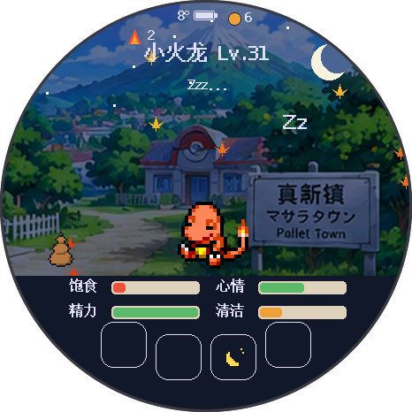<br>主屏幕（夜里睡着了）</td><td align="center">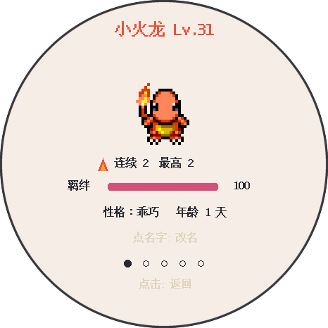<br>宠物卡片</td><td align="center">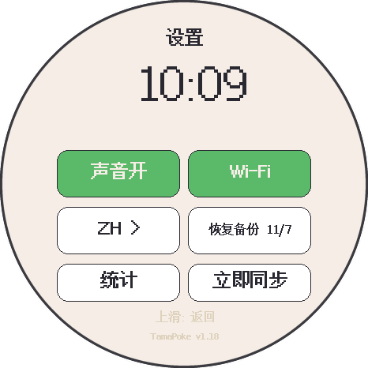<br>设置</td></tr></table>

<table><tr><td align="center">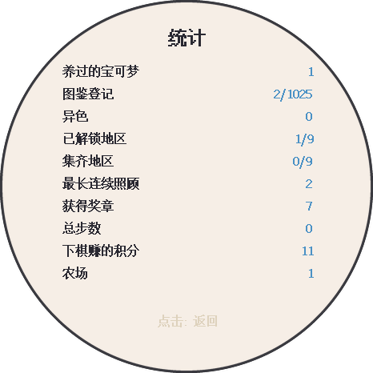<br>统计</td><td align="center">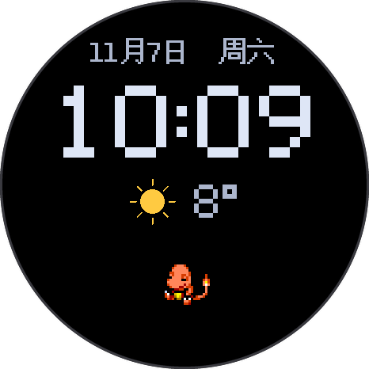<br>待机时钟</td></tr></table>

### 照顾

- 四项需求，每项 0 到 100：饱食、心情、精力、清洁。醒着时每分钟下降，睡着时慢很多。
  便便会拉低清洁。
- 任何一项降到 10 或以下，算一次**照顾失误**（每小时最多算一次）。便便有两坨以上、
  太胖，或者任何一项降到 20 或以下，都可能让它**生病**：要喂药，否则生病期间每 2 小时
  算一次失误。如果它醒着病了 10 分钟，会自己从背包里拿药吃，背包里没有就用你的积分买。
- 四项全部为 0 并持续一小时，会出现"逃走"按钮。
- **夜里：** 如果灯还开着，它会在 23:00 自己睡着，07:00 醒来。用 PWR 键关掉屏幕，它也会去睡。
- **自己照顾自己：** 插着电、10 分钟没人碰时，它会把低于 40 的需求补到 50，每分钟补一项。
  这不算你的照顾。
- **性格**（孵化时随机）：乖巧、贪吃、爱玩、爱干净、懒洋洋。某一项需求会掉得稍快，
  它喜欢的那种照顾效果也更好。

### 成长

- 进化看**天数**，所有进化链都一样：第一次在第 3 天，第二次在第 5 天。每次照顾失误推迟
  2 小时，而且四项需求都要在 40 以上。时间到了会出现按钮，可以选择进化，也可以保持现在的
  样子。**进化药水**（100 积分）能让它马上进化。
- 最终形态满 **7 天**后它会道别（你可以选择再陪它一段时间）。道别后它会进入相册，你可以
  开一个新蛋。
- **能力**（0-100，没有对战）：体力（体力药剂）让精力最多慢一半下降；活力（活力药剂）让
  心情最多慢一半下降；抵抗力在连续好好照顾时每 3 小时加 1，最多让生病的几率降低 60%。

<table><tr><td align="center">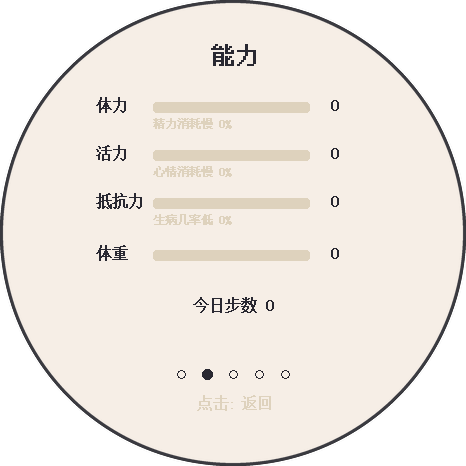<br>能力</td><td align="center">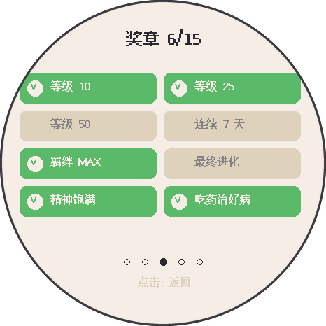<br>奖章</td></tr></table>

### 积分和商店

开局有 10 积分。基本照顾都是免费的。

- **chess.com**（设置了 `CHESS_USER` 才有）：每天午夜同步一次，错过时在下次开机同步，也可以
  点**立即同步**。基础时间 10 分钟以上的对局或每日对局得 1 分，赢一盘得 10 分；没有计时的
  对局（和电脑下）不算。快棋或每日棋创新高得 20 分，快棋每突破一个新的百位整数得 50 分，
  战术题或 Puzzle Rush 创新纪录得 10 分。第一次同步只记录你当前的成绩，不补发以前的分。
- **走路步数**（运动传感器统计）：每 1000 步 1 分，每天最多 5 分。
- 集齐一个地区的图鉴：200 分、一顶皇冠，以及一个该地区的异色传说蛋。
- 每天 07:00 后农场有一点小收获。

| 道具 | 积分 |
|---|---|
| 糖果（加心情和饱食，但会变胖） | 2 |
| 药 | 3 |
| 体力药剂 / 活力药剂 | 各 5 |
| 进化药水 | 100 |
| 异色护符 | 50 |
| 普通蛋 / 稀有蛋 / 传说蛋 | 10 / 30 / 100 |
| 装饰品（蝴蝶结、小花、棒球帽、巫师帽、礼帽、皇冠） | 15-80 |

只有在没有搭档时才能开蛋。

<table><tr><td align="center">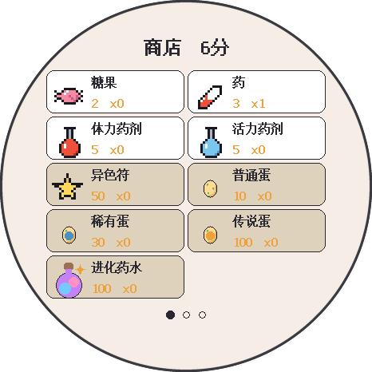<br>商店</td><td align="center">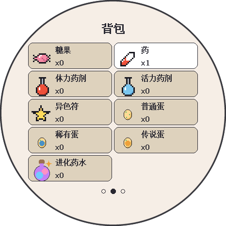<br>背包</td><td align="center">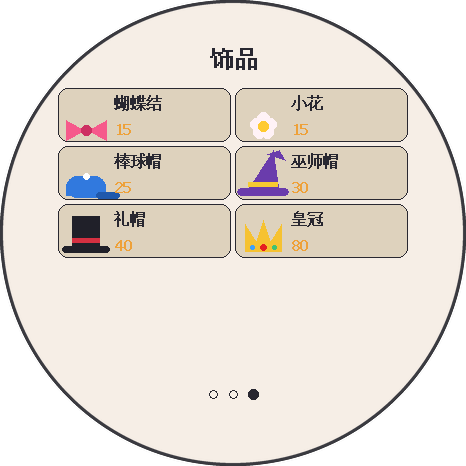<br>装饰品</td></tr></table>

### 图鉴、农场和相册

- 9 个地区按顺序开放：上一个地区里所有普通和稀有的宝可梦都登记后，下一个地区才开放。
  蛋里只会孵出已开放地区的宝可梦。
- **农场**把你送过去的伙伴存在 SD 卡上。它们会以十分之一的速度继续长大（但不会进化），
  接回来时是健康的，偶尔还会走到主屏幕上来串门。农场里已有的种类不会再从蛋里孵出，也不会
  通过进化得到。
- **相册**为每位离开的伙伴留一页，记录日期、等级、奖章和它离开的方式。
- 游戏进度每天**备份**到 SD 卡一次（不包括 Wi-Fi 信息），可以在设置里恢复。

<table><tr><td align="center">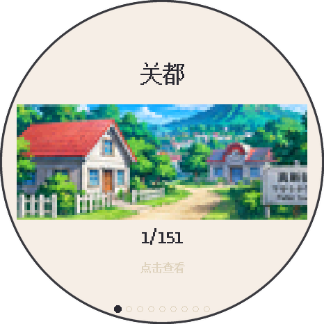<br>地区封面</td><td align="center">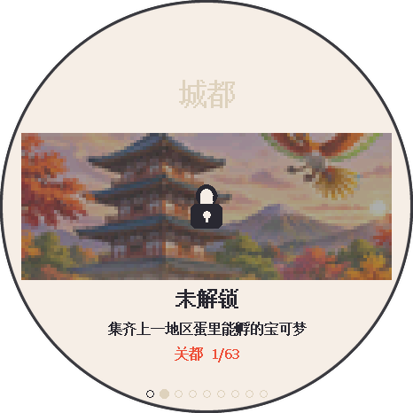<br>未开放的地区</td><td align="center">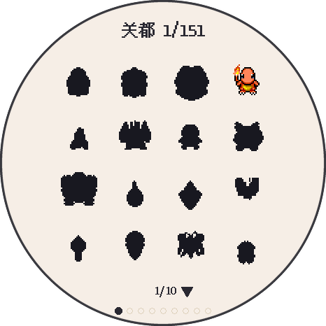<br>地区列表</td></tr></table>

<table><tr><td align="center">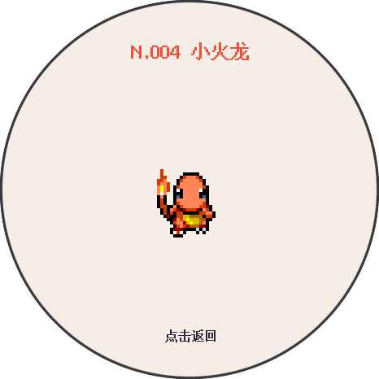<br>图鉴详情</td><td align="center">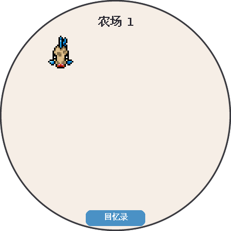<br>农场</td><td align="center">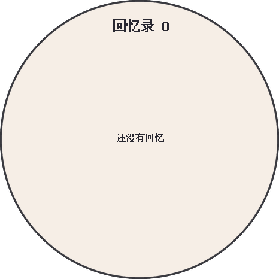<br>相册</td></tr></table>

### 环境和电源

- 天气来自 Open-Meteo：插电时每小时更新一次，用电池时每 3 小时一次（00:00 到 06:00 不更新）。
  雨、雪、雾、雷暴会显示在屏幕上，并按宠物的属性影响心情；日出日落决定白天和黑夜。
- 季节、节日（元旦、春节、元宵、情人节、复活节、母亲节、父亲节、端午、加拿大国庆、中秋、
  感恩节、万圣节、圣诞节）和生日（通过串口用 `BDAY 月 日` 设置）。
- **待机时钟：** 插着电、90 秒没人碰时，屏幕会显示大时钟，以及日期和天气。
- 开机时和之后每小时通过网络校准时间。

### Stack-chan / 小智（可选）

保存了小智 MCP 接入点并插着 USB 电源时，板子会一直在线，作为 MCP 服务器。小智的智能体
（比如 Stack-chan 上的）可以查看宠物状态，喂食、陪玩、洗澡、哄睡或叫醒，喂糖果或药，
查询下棋积分和图鉴进度，买便宜的道具，以及列出农场里的宝可梦。

## 开发

```bash
./test/run_tests.sh            # 电脑上跑的 C++ 测试
python3 test/test_tools.py     # 程序和工具的检查
python3 tools/test_i18n_formats.py
```

- 中文字库：`tools/make_zh_font.py` 用 U8g2 仓库（`tools/font/bdf`）里的文泉驿 BDF 文件
  生成 `zhfont.h`，只保留实际会显示的字。新增中文文字后要重新运行。
- 地区图片：`tools/make_regions.py` 根据 `tools/assets/regions_source.png` 生成 `regions.h`
  和背景文件 `bgN.bin`。
- 图鉴数据：由 PokéAPI 生成（`tools/gen_dex*.py`）。
- 调试用的串口控制台，波特率 115200，比如 `HEALTH`、`STATS`、`SHOT`（截屏）、`WX`、`SYNC`。
- 发布前，`tools/privacy_check.py` 会检查要上传的内容里有没有 `config_private.h` 里的值，以及
  本地可选的 `.privacy_denylist` 里的词。它可以作为 `pre-push` 钩子自动运行。

## 致谢

- 原项目：[socquique/TamaPoke](https://github.com/socquique/TamaPoke)，作者 Quique Tortosa
  及其他贡献者。
- 精灵图：[PMD SpriteCollab](https://github.com/PMDCollab/SpriteCollab)（CC BY-NC 4.0，
  每张图的作者见其 `tracker.json`）。
- 宝可梦数据和名字：[PokéAPI](https://pokeapi.co)。
- 中文字体：文泉驿点阵宋体，取自 [U8g2](https://github.com/olikraus/u8g2) 仓库。
- 天气数据由 [Open-Meteo.com](https://open-meteo.com/) 提供（CC BY 4.0）。
- 象棋数据来自 [chess.com 公开数据 API](https://www.chess.com/news/view/published-data-api)。
- 库：Arduino_GFX（moononournation）、SensorLib 和 XPowersLib（Lewis He）、U8g2（olikraus）、
  ArduinoJson（Benoît Blanchon）、WebSockets（Markus Sattler）。
- 地区风景图：为本分叉用 AI 生成。

## 许可

- 代码：MIT，见 [LICENSE](LICENSE)。本分叉的改动采用同样的许可。
- 精灵图（`tools/sdcard/mons`）：CC BY-NC 4.0，来自 PMD SpriteCollab，不可商用。
- 原项目在 MakerWorld 上的 3D 外壳：CC BY-NC-SA。
- 宝可梦的名字和角色归其权利人所有。
